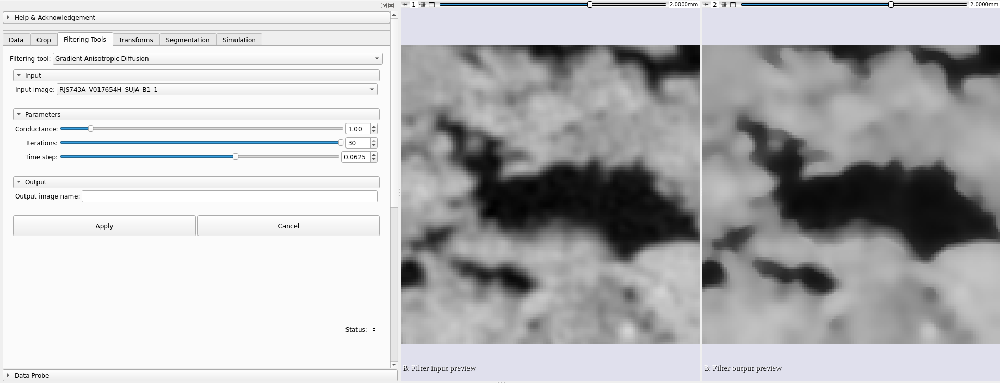
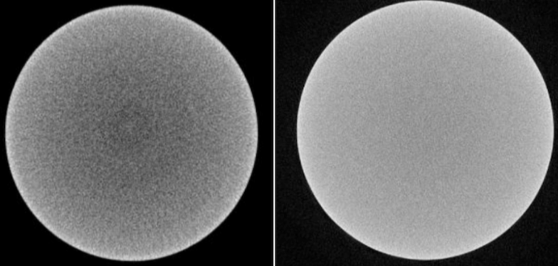
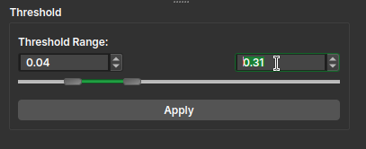

## Gradient Anisotropic Diffusion

In many applications, it is assumed that transitions from a light to a dark region (characterized by a high gradient) are of interest. While other filters, such as median and Gaussian, often blur boundaries, making pore delimitation more confusing, anisotropic diffusion filters tend to avoid this type of confusion. The conductance term is a function of the image gradient magnitude at each point, reducing the diffusion strength at edges.

|                                                                                  |
|:------------------------------------------------------------------------------------------------------------------------:|
| Left: Original volume, uncorrected. Right: After correction with anisotropic gradient diffusion filter. |

The numerical implementation of this equation available in _GeoSlicer_ is similar to that described in the Perona-Malik paper, but uses a more robust technique for gradient magnitude estimation and is generalized to N-dimensions.

The module parameters for calculating anisotropic gradient diffusion are:

- **Conductance** (_Conductance_): Controls the sensitivity of the conductance term. As a general rule, the lower the value, the more strongly the filter will preserve edges. A high value will cause diffusion (smoothing) of the edges. Note that the number of iterations controls how much smoothing will occur within regions delimited by edges.

- **Iterations** (_Iterations_): More iterations lead to greater smoothing. Each iteration takes the same amount of time. If one iteration takes 10 seconds, 10 iterations take 100 seconds.

- **Time step** (_Time step_): The time step depends on the image dimensionality. For three-dimensional images, the default value of 0.0625 provides a stable solution. In practice, altering this parameter causes few changes to the image.

---

## Curvature Anisotropic Diffusion

Performs anisotropic diffusion on an image using a _Modified Curvature Diffusion Equation_ (MCDE).

MCDE does not exhibit the edge enhancement properties of classic anisotropic diffusion, which under certain conditions can undergo "negative" diffusion, increasing edge contrast. Curvature anisotropic diffusion always undergoes positive diffusion, with the conductance term only varying the strength of this diffusion.

Qualitatively, MCDE compares well with other non-linear diffusion techniques. It is less sensitive to contrast than classic Perona-Malik type diffusion and preserves finer, more detailed structures in images. There is a potential speed disadvantage when using this function instead of the *Gradient Anisotropic Diffusion*. Each iteration of the solution takes approximately twice as long. Fewer iterations, however, may be necessary to achieve an acceptable solution.

The parameters required for the curvature anisotropic diffusion calculation are the same as those for the anisotropic gradient method.

---

## Gaussian Blur Image Filter

Applies a Gaussian blur filter to the volume; the only parameter is _Sigma_, representing the width of the Gaussian in mm units.

---

## Median Image Filter

Applies a median filter to the volume; the _Neighborhood size_ parameter defines the neighborhood size in voxels in each of the directions.

---

## Non-Local Means Filter

Removes noise while preserving edges and fine textures. For each voxel, the filter searches its surroundings for patches with a similar appearance and averages the voxels at the center of these patches, giving more weight to the most similar ones. Unlike Gaussian and median filters, which average only immediate neighbors, it averages regions that look alike even if they are a few voxels apart, so grain boundaries and small pores are better preserved. The implementation is the one from [scikit-image](https://scikit-image.org/docs/stable/api/skimage.restoration.html#skimage.restoration.denoise_nl_means).

The module parameters are:

- **Mode**: _3D_ compares patches across the whole volume, using the information of neighboring slices. _2D (slice by slice)_ filters each axial slice independently, which is faster and suited to images with strong differences between slices.

- **Strength (× noise std)**: Filter strength _h_, as a multiple of the noise standard deviation. Higher values smooth more, at the cost of fine details. Recommended values are about 0.45 to 0.6 in 3D and 0.6 to 0.8 in 2D. When the mode changes, the strength is set to the default of the new mode (0.5 for 3D, 0.7 for 2D) unless it was edited.

- **Noise std**: Standard deviation of the image noise, in intensity units. With _Estimate_ checked, it is estimated from the image itself, ignoring null regions around the sample. Uncheck it to type a known value. The values used are shown below the _Apply_ button once the filter finishes.

- **Patch size (voxels)**: Side of the patches compared to find similar regions. Larger patches are more robust to noise but slower, and may blur features smaller than the patch.

- **Search distance (voxels)**: Maximal distance to search for similar patches. Processing time grows quickly with this value, especially in 3D.

- **Fast mode**: Uses a faster patch comparison with uniform weights. When unchecked, patch comparisons are weighted by a Gaussian, which is slightly more accurate but much slower. Only available in 2D, since 3D always uses the fast comparison.

Voxels with the image's null value are kept unchanged. RGB images, usually greyscale images exported with three channels, are converted to single-channel greyscale before filtering, and a warning is shown above the _Apply_ button when this will happen.

---

## Euclidean Distance Transform

Calculates the Euclidean distance transform of a binary image. The output image contains, for each voxel, the distance to the nearest non-zero voxel in the input image.

### Usage
1. Select the input binary image. Scalar images also work, but only non-zero voxels are considered as foreground.
2. If the input has more than one label, select the desired label value to be considered as foreground. It is possible to select multiple segments.
3. If the input is a scalar or just have one label, the selection of label value is hidden.
3. Choose a prefix for the output image name.

---

## Simple Filters

This module, loaded from the original 3D Slicer, presents a diverse set of filters for calculating binary and grayscale morphology, noise removal, thresholding, image intensity manipulation, region growing, Fourier transform, etc. For a more detailed explanation of each of the options available in this module, consult the [specific](https://slicer.readthedocs.io/en/latest/user_guide/modules/simplefilters.html) documentation.

---

## Polynomial Shading Correction

Tomography images often exhibit variations in intensity values that are not characteristic of the sample, but rather of the equipment that collected them. These variations are called artifacts, and there are several types of them. The *Polynomial Shading Correction* module corrects the artifact known as _beam hardening_, among others. It is also known as _background_ correction.

|                                                                                  |
|:------------------------------------------------------------------------------------------------------------------------:|
| Left: _Beam hardening_ artifact present. Right: Corrected image after applying _shading correction_. |

The entire procedure described below is performed slice by slice, in the axial (z-axis) plane of the sample.

For each slice, based on the "Number of fitting points" parameter, a random sample is taken from intensity values at points belonging to the shading mask. These points are used to fit a mathematical function that defines the image background. Depending on the chosen function, this could be a generic Cartesian polynomial, a strict radial polynomial, or a spline profile. For example, a basic second-degree Cartesian polynomial follows this equation:

$$f(x,y) = a (x-b)^2+c(y-d)^2+e(x-b)+f(y-d)+g(x-b)(y-d) + h$$

The fitted function is then used to perform the correction on the slice, following the equation:

$$s'(x,y) = \frac{s(x,y)}{f(x,y)}M$$

Where, $s'(x,y)$ is the corrected slice, $s(x,y)$ is the original, and $M$ is the average of all data in the shading mask (constant value).

The _Shading Correction_ module workflow is divided into three steps: initialization, sampling mask definition, and processing.

#### Initialization

1.  **Input image:** Select the input image you want to correct.
2.  **Keep intermediate image:** Check this option if you wish to keep the pre-normalized image generated during the initialization step. This intermediate image facilitates the thresholding step.
3.  Click the **Initialize** button. This will pre-normalize the input image and prepare the segment editor for creating the sampling mask.

#### Threshold

1.  After initialization, a segment editor interface with the **Threshold** effect will be displayed to create a mask that covers the image areas affected by shading. This mask will be used to sample points for fitting.
2.  After adjusting the threshold, click **Apply** in the Threshold effect panel.

!!!tip
	Consider the mineral in which the _beam hardening_ effect is most clearly appearing. For example: If this is the case for calcite, simply click + drag with the mouse near a region with this mineral; a yellow circle should appear, and you should see the segmentation coloring near the region, depending on the circle's radius.

!!!tip
	For a finer and more sensitive segmentation adjustment, hover your mouse over one of the selection boxes with the maximum/minimum values and use the mouse wheel to increase or decrease the upper/lower limit.
	
	

#### Parameter Selection

1.  **Function:** Select the mathematical model used for the shading correction:
    * **Polynomial:** Fits a 2D Cartesian surface. Best for general, non-symmetric shading gradients across the image.
    * **Polynomial Radial:** Fits a curve based strictly on the distance from the center. Best for broad, circular shading effects like standard beam hardening.
    * **Spline Radial:** Calculates a median radial profile and uses splines to handle fine, high-frequency ring artifacts.
2.  **Center:** Define the center point for the radial mathematical curve fitting:
    * **Default:** Automatically uses the geometric center of the image (leave "Custom" unchecked).
    * **Set:** Check to manually input the X and Y center coordinates.
    * **Pick Red View:** Click to interactively select the center point directly on the Red slice view.
3.  **Order:** Select the complexity of the polynomial curve (2, 4, or 6). *Note: This parameter is ignored if 'Spline Radial' is selected.*
    * **Lower orders (2):** Capture broad, gentle shading gradients. Less prone to errors.
    * **Higher orders (6):** Allow for more complex, wavy curves but increase the risk of overfitting to local image features instead of the overall shading trend.
4.  **Group size:** Define the number of slices that will share the same fitted mathematical function. **Smaller values yield better results, but processing is slower** as more individual fits must be calculated.
5.  **Fitting points:** Define the number of points to be randomly sampled from the mask for the function fitting process. **Larger values yield better results, but processing is slower** due to the increased computational load of the fitting algorithm.
6.  **Output image name:** Enter the desired name for the corrected output image volume.

#### Apply

1.  **Apply:** Click to start the correction process on the input image.
2.  **Apply to full volume:** If your input image is a virtual image (_lazy node_), this button will be visible. Clicking it will open the **Polynomial Shading Correction Big Image** module, which is optimized for processing large images. The parameters defined in this module will be automatically transferred to the big image module.

---

## Ring Artifact Removal

Removes ring artifacts from already reconstructed CT/micro-CT volumes. The correction is done slice by slice, around one or more centers marked by the user: the systematic bias that is constant at a given radius (equal at every angle) is isolated and subtracted, without resampling the image, so the real texture is not blurred. A second mode, _Radial fan_, removes streaks that emanate from a fixed point (e.g. a dense inclusion or metal grain).

### Usage
1. Select the **Input volume**.
2. Choose the **Artifact type**: _Ring (circular)_ or _Radial fan (streaks emanating from a point)_.
3. In **Correction**, click _Add point_ to place a marker at an estimated center, then drag it onto the center of each visible ring. In _Ring_ mode the estimate is the rotation center stored with the volume (when the file has it) or, otherwise, the image center. Without any marker, the correction uses that same estimate. For the _Radial fan_ mode, mark exactly one point; the marker is placed on the dense grain the streaks emanate from, found automatically.
4. Adjust the parameters: _Ring width_ (Ring mode), or _Streak width_ and _Radial coherence_ (Radial fan mode). Optionally set a **Radius range** (in pixels from each point) to correct only that band; the correction fades in and out at its ends, and _No limit_ leaves the outer end open.
5. Click **Preview on current slice** to see the slice before, after and the difference (before - after) side by side. Use **Exit preview** to go back to the previous layout.
6. Set the **Output name** and click **Apply to entire volume**.

!!!note
	Not every radial pattern is a classic ring artifact. If the correction is negligible even with a well-adjusted center, the pattern is probably a "zinger"-type artifact, which can only be properly fixed in the sinogram, before the reconstruction.
