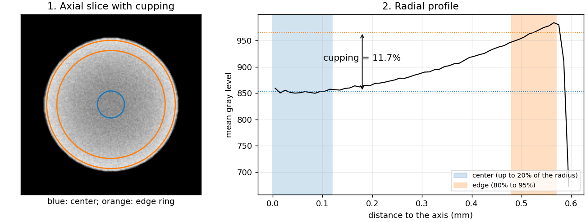
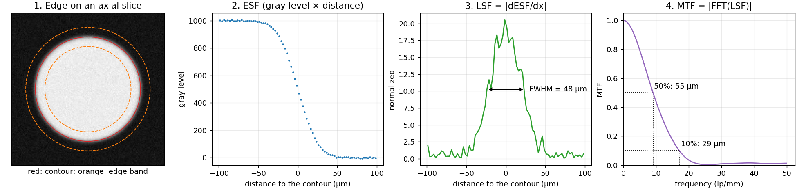
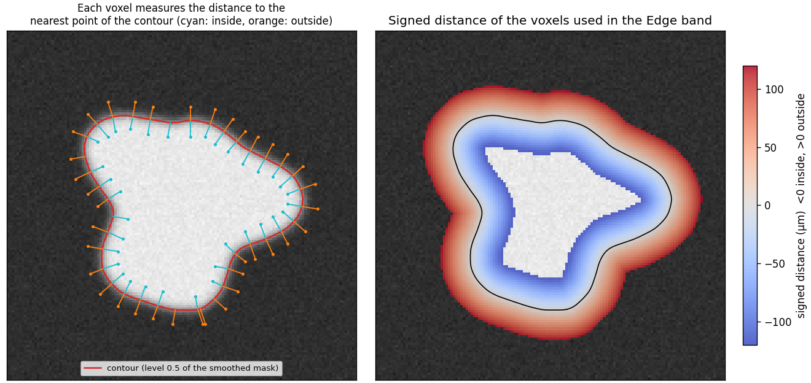

## Image Metrics

Measures the quality of a micro-CT volume from regions you segment: signal-to-noise ratio (SNR), contrast-to-noise ratio (CNR), cupping and the spatial resolution (MTF, modulation transfer function) across an edge. Each run adds a row to a results table so scans made with different acquisition settings can be compared and exported as CSV.

### How to Use

The module works from **one segmentation with a segment for each material of the scan**. Each metric then asks which of those segments it should use, so a single click on **Apply** measures the whole scan.

#### Input

1. **Volume:** the reconstructed micro-CT volume.
2. **Segmentation:** the segmentation with the segments of the scan.

#### Metrics

Each metric has its own box. Tick the ones you want and choose its segments. The **?** button next to each box explains in detail what the metric means and how to read it.

| Metric | What it tells | Segments to choose |
|:--|:--|:--|
| **SNR** | Noise: mean / standard deviation of the gray levels. Higher is cleaner. | Any number of segments, checked in a list. One SNR value is reported for each. Use homogeneous areas, away from interfaces. |
| **CNR** | Whether two phases can be told apart: \|mean A − mean B\| / sqrt(std A² + std B²). | **Phase A** and **Phase B**, any two segments of the scan. They do not need to touch. |
| **Cupping (%)** | Beam hardening: (meanedge − meancenter) / meanedge × 100. Near 0 is good, positive means the center is darker than the wall. | **Region**: *All segments* (default, the whole sample as one region) or a single segment. It should be the whole cross-section. With a pore or air segment in the segmentation, pick the sample segments one by one, because the pore would pull the radial average. |
| **MTF** | Spatial resolution: size of the smallest detail resolved at 50% and 10% of the contrast (µm), LSF FWHM. Smaller is sharper. | **Side A** and **Side B** of an edge, for example inside and outside the tube. They must **touch**. |

#### How the cupping is measured

|                                     { width=65% }                                     |
|:--:|
| Synthetic cylinder with beam hardening. 1: an axial slice, with the center (blue) and the edge ring (orange). 2: radial profile, with the two regions and the resulting cupping. |

1. **Axis.** The tube axis is assumed parallel to Z and goes through the centroid of the selected region.
2. **Radial profile.** The mean gray level is computed as a function of the distance to the axis. With beam hardening the center is darker than the wall, so the profile rises toward the edge.
3. **Center and edge.** The center is the mean up to a percentage of the radius (default 20%) and the edge is the mean between two percentages (default 80% to 95%), which leaves out the interface voxels.
4. **Cupping (%)** = (meanedge − meancenter) / meanedge × 100. In the figure, 853 at the center and 966 at the edge give 11.7%.

#### How the MTF is measured

The MTF is obtained from the blur of a single edge, in four steps:

|                                                                          |
|:--:|
| Synthetic tube with a blur of 2 voxels (10 µm voxels) and noise. 1: an axial slice, with the interface contour (red) and the edge band (dashed). 2: ESF. 3: LSF and its FWHM. 4: MTF with the 50% and 10% levels. |

1. **Locate the edge.** On each axial slice the contour between side A and side B is found with sub-voxel precision. Only the voxels within the **Edge band** of the contour are used. It is the half-width of that region, in voxels: use at least 4 times the blur you expect (the default of 10 voxels suits edges blurred over a few voxels).
2. **ESF (edge spread function).** Each voxel gives one point: its distance to the contour (negative on side A, positive on side B) and its gray level. Averaging the points by distance, on all the slices, gives the profile of the edge. A sharp edge is a step, a blurred edge is a ramp.
3. **LSF (line spread function).** It is the absolute derivative of the ESF, normalized to unit area. It is a peak centered on the edge: the narrower the peak, the sharper the image. Its width at half height is the **LSF FWHM**.
4. **MTF.** It is the magnitude of the Fourier transform of the LSF, normalized to 1 at frequency zero. It tells which fraction of the contrast survives at each spatial frequency (in line pairs per mm). The frequency where it falls to 50% and to 10% is converted to the size of the detail, 1 / (2 f), and reported as **Resolvable at 50%** and **Resolvable at 10%**.

A wide LSF means a narrow MTF: a blurrier image loses the contrast of small details at lower frequencies.

!!! note "Curved edges"
    The distance is measured to the nearest point of the contour, that is, perpendicular to the edge at each point, so the MTF also works for curved edges such as a grain. It is computed within the axial slice, so the edge should be roughly parallel to Z.

    |                                     { width=65% }                                     |
    |:--:|
    | Grain with an irregular shape on an axial slice. Left: each voxel is connected to the nearest point of the contour (red). Right: signed distance of the voxels inside the edge band (negative inside the grain). |

#### Reading the MTF

The MTF says how much of the contrast of a detail survives as the detail gets smaller. It starts at 100% for large details and falls as they shrink. The table reports two points of that curve, as the size of the detail (in µm):

| Column | Meaning |
|:--|:--|
| **Resolvable at 50% (µm)** | Size of the detail that keeps **half** of its contrast. Details of this size are still clearly visible. It sits in the high-contrast part of the curve, so it is little affected by noise: the best value to compare scanners or acquisition settings. |
| **Resolvable at 10% (µm)** | Size of the detail that keeps **a tenth** of its contrast. It is the practical limit of the image: smaller details are lost in the noise. Since it is on the low part of the curve, it is more sensitive to noise. |
| **LSF FWHM (µm)** | Width of the blurred edge at half height: another way of looking at the same blur. |

For example, with 10 µm voxels, *50% = 30 µm* and *10% = 18 µm* means that 30 µm details are seen with half of their contrast, those between 18 and 30 µm fade, and nothing under 18 µm is resolved. The MTF plot shows the contrast kept for each detail size in µm (size = 500 / f, where f is the frequency in line pairs per mm) and marks these two sizes.

!!! note
    The MTF interface should be roughly perpendicular to the slices, like the wall of a tube along Z or a flat face parallel to Z. For an interface that is mostly horizontal, such as the top of a sample, the axial slices cut it obliquely and the edge looks blurrier than it is. The segments may be made by a threshold of the image itself: the contour is smoothed, so the segmentation noise does not sharpen the measured edge. Tests with synthetic edges recover f50 and the LSF FWHM within about 2% for blur between 0.8 and 3 voxels.

!!! tip
    A metric that cannot be computed (for example an MTF between segments that do not touch) does not stop the others. The module adds the row with what worked and lists what failed.

#### Acronyms

| Acronym | Meaning |
|:--|:--|
| **SNR** | Signal-to-Noise Ratio |
| **CNR** | Contrast-to-Noise Ratio |
| **MTF** | Modulation Transfer Function: the fraction of the contrast of a detail that the image preserves, as a function of the detail size |
| **ESF** | Edge Spread Function: the gray level across an edge, as a function of the distance to it |
| **LSF** | Line Spread Function: the derivative of the ESF; its width measures the blur |
| **FWHM** | Full Width at Half Maximum: the width of a peak at half of its height |
| **LSF FWHM** | The FWHM of the LSF, in µm: the width of the blurred edge at half height. It is the column of the results table; smaller is sharper |
| **lp/mm** | Line pairs per millimeter: the unit of spatial frequency in the MTF |

#### Results

- The plots show the radial profile and the MTF curve of the last run, with the 50% and 10% levels.
- **Clear table** removes all rows and **Export CSV** saves the table.
