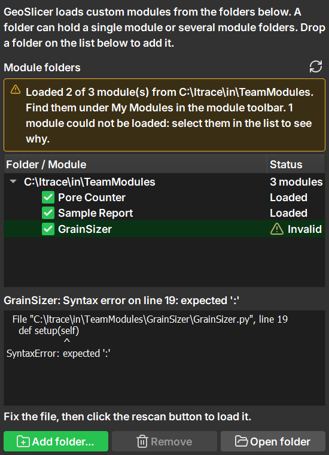

# Module Manager

The **Module Manager** loads custom modules, developed by users or teams outside of GeoSlicer, directly from folders on disk. Modules run from their own folders, so nothing is copied into the GeoSlicer installation, and sharing a module with colleagues is as simple as sharing its folder, for example on a network drive.

The module can be opened through the **Module Manager** button in the dialogue bar, in the lower right corner, or through **Manage modules...** in the **My Modules** menu of the module toolbar.

### Module folders

The list in the center of the module shows the registered folders and the modules found in each of them. A registered folder can be:

- A single module folder, such as `MyModule/` containing `MyModule.py`;
- A collection of module folders, such as `TeamModules/` containing `MyModule/MyModule.py` and `OtherModule/OtherModule.py`. Collections can be grouped one level deeper, as in `TeamModules/Imaging/MyModule/MyModule.py`.

To add a folder, click **Add folder...** or drag it from the file browser and drop it on the folder list. Dropping a module's `.py` file adds the folder it is in, and several folders can be dropped at once. Symbolic links are followed.

Each module is listed under a single folder. Adding a folder whose modules are already listed, such as a module inside a registered collection, only selects them in the list. Adding a collection that includes registered folders replaces them.

Modules added later to a registered collection are found the next time GeoSlicer starts, or right away by clicking the rescan button above the folder list.

A folder on a network drive that can't be reached is shown as **Not reachable** and skipped, so it doesn't hold up GeoSlicer's start. It is checked again on the next rescan.

The buttons below the list act on the selected folder:

- **Remove**: stops loading modules from the folder. Its modules stay loaded until GeoSlicer is restarted;
- **Show in files**: shows the folder in the file browser.

The outcome of each action, such as how many modules were loaded from a folder, is shown in a message between the "Module folders" title and the list.

### Using custom modules

Loaded modules are listed under **My Modules**, at the end of the module toolbar. The **Add Module** button next to it goes straight to the folder selection: if the chosen folder holds a single module, that module is opened; otherwise, the Module Manager is opened to show what was loaded.

Double-clicking a module in the folder list also opens it.

Custom modules show developer tools, marked **DEV**, in the header of the module panel, next to the manual button:

- The reload button applies changes to the module's code without restarting GeoSlicer;
- The edit button opens the module's file in the Python editor set in the application settings.

### Enabling and disabling modules

Each module in the folder list has a checkbox. Unchecking it disables the module: it is no longer loaded the next time GeoSlicer starts. Checking it again loads the module immediately. The choice is remembered for each module file.

!!! note "Note"
    GeoSlicer can't unload a module that is already loaded. A disabled module only stops running after GeoSlicer is restarted.

### Writing a module

[Create a New GeoSlicer Module](https://github.com/petrobras/GeoSlicer/blob/main/CONTRIBUTING.md#create-a-new-geoslicer-module)

### Modules with errors

Modules that can't be loaded are marked with a warning icon in the folder list. Selecting one shows its error below the list, along with the traceback when there is one. Errors fall into two groups:

- **Invalid**: a file named after its folder (such as `MyModule/MyModule.py`) has a syntax error, doesn't define a class with the same name as the file, or its class doesn't derive from `LTracePlugin` or set `self.parent.categories`. None of its code runs, so once the file is fixed the module is loaded on the next rescan;
- **Failed to load**: the module raised an error while being loaded. It is disabled, so that it doesn't run again on every start, and its error is kept. After fixing the error, check the module to load it again.

If GeoSlicer closes unexpectedly while loading a custom module, that module is disabled on the next start and a message tells which one it was. It stays disabled until it is checked again.
