## Spectral Profile

The **Spectral Profile** module segments a sample from **how the attenuation of each pixel changes with the energy of the X rays**. Different minerals can have the same attenuation at a single energy, but they respond differently when the energy changes: the photoelectric effect (which depends on the atomic number) falls quickly with the energy, while Compton scattering (which depends on the electron density) hardly changes. Measuring the sample at several energies separates these two effects.

The module works with two kinds of data that complement each other:

- **Multi-energy scan (2D):** a cross section of the sample scanned with many tube voltages, one slice per voltage. The *z* axis of the volume is the energy axis, not the depth. This data separates the minerals well and is used to find **which classes** the sample has.
- **Dual Energy volumes (3D):** the whole sample scanned at only two energies. They cover the full volume, but with only two values per voxel. The 3D segmentation uses these two volumes.

The result is always a **segmentation** with a **properties table** (`<name>_properties`) holding the electron density, the effective atomic number (Zeff), the density and the suggested mineral of each class.

!!! note "About the images"
    All the images of this page come from a **synthetic sample**, generated with the same physical model the module uses, with noise: a cylinder with quartz, calcite, dolomite, a few pyrite grains and pores, and a multi-energy slice of it.

| 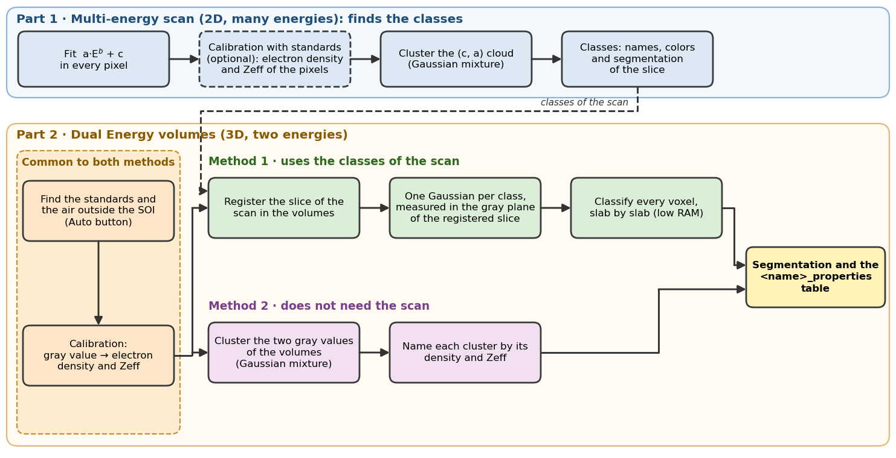 |
|:-----------------------------------------------:|
| Figure 1: Overview of the module. Part 1 (multi-energy scan) finds the classes; its calibration with standards (dashed) is optional. In Part 2, the calibration with the standards of the Dual Energy volumes is common to both methods. Method 1 uses the classes of the scan; Method 2 works without the scan. |

!!! note "When to use each part"
    - You only have the 2D multi-energy scan: use the **Input**, **Spectral axis**, **Calibration with standards** and **Clustering** sections (Part 1).
    - You have the 3D Dual Energy volumes: use the **Dual energy 3D** section (Part 2). It can use the classes of the multi-energy scan or work alone, clustering the two volumes.

---

### Fundamentals

#### Why more than one energy

The attenuation of a material at the tube voltage $E$ has two contributions with very different behavior:

- the **Compton** contribution, almost constant with the energy, proportional to the **electron density** $\rho_e$;
- the **photoelectric** contribution, which grows quickly towards low energies and is proportional to $\rho_e \cdot Z_{eff}^{\,n}$, where $Z_{eff}$ is the effective atomic number.

At high energy only the first one remains, and minerals with similar density look alike. At low energy the second one appears and separates minerals of different composition, as quartz, dolomite and calcite below.

| 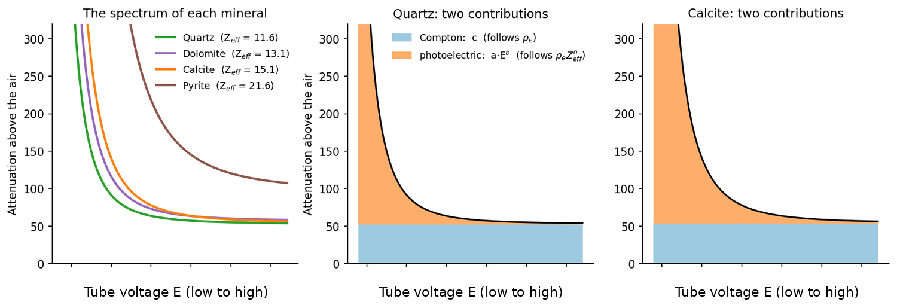 |
|:-----------------------------------------------:|
| Figure 2: Attenuation of four minerals as a function of the tube voltage (left) and its two contributions for quartz and calcite (center and right). The curves are almost equal at high voltage and split at low voltage. |

#### The attenuation model

In each pixel of the multi-energy scan, the attenuation (gray value above the air) is fitted by

$$ \text{attenuation}(E) = a \cdot E^{\,b} + c $$

where $E$ is the tube voltage, scaled so as to keep $a$ and $c$ with similar sizes.

- **c** is the energy independent term, dominated by Compton scattering. It follows the **electron density**: $c = \beta \cdot \rho_e$.
- **a** is the photoelectric term (the attenuation it adds at $E = 1$). It follows the electron density and, quickly, the effective atomic number: $a = c \cdot K \cdot Z_{eff}^{\,n}$.
- **b** is the energy exponent (default -3.5). Photoelectric absorption goes with $E^{-3}$ to $E^{-3.5}$, so $b$ is usually between -3 and -3.5.

Each pixel is then described by only two numbers, $(c, a)$. The lines of constant $\rho_e$ are vertical and the lines of constant $Z_{eff}$ are rays from the origin, so each material is a point of this plane and different minerals occupy different regions of it. The clustering is done in this plane.

| 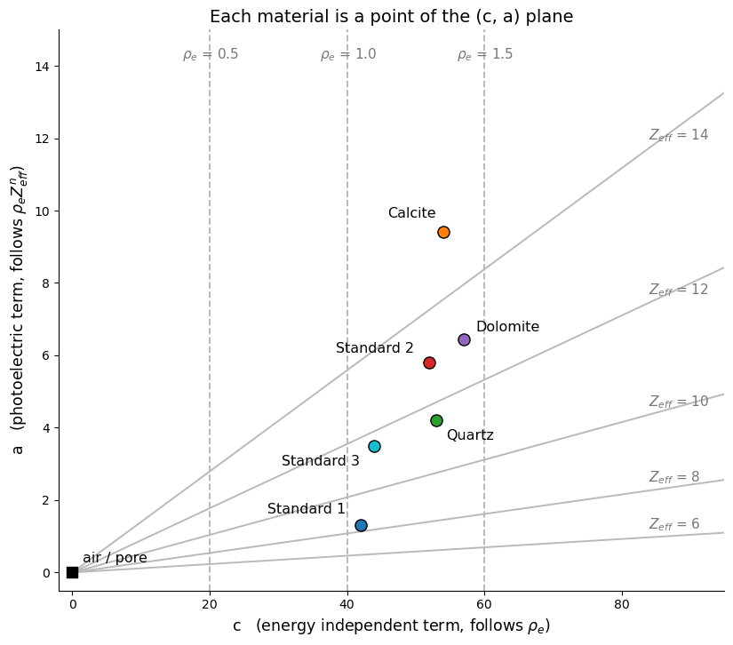 |
|:-----------------------------------------------:|
| Figure 3: The $(c, a)$ plane. Vertical dashed lines: constant electron density. Rays: constant $Z_{eff}$. |

| 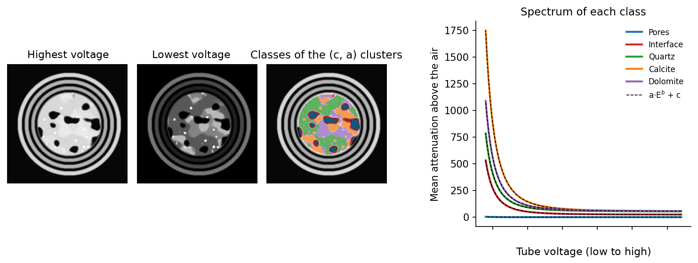 |
|:-----------------------------------------------:|
| Figure 4: Slices of the multi-energy scan at the highest and the lowest voltage, the classes obtained, and the mean spectrum of each class (solid line) with the fit $a \cdot E^b + c$ (dashed). At low energy the curves split, and this split is what tells the minerals apart. |

#### Calibration with standards

The pair $(c, a)$ has no physical unit. To convert it into properties, the module uses **standards** of known composition and density, scanned together with the sample. Their formula gives the electron density and the Zeff of each standard. With them, the module fits two relations:

- $c = \beta \cdot \rho_e$, which gives the **electron density** (mol/cm³);
- $a / c = K \cdot Z_{eff}^{\,n}$, which gives the **Zeff**;
- the **density** (g/cm³) is the electron density divided by $Z/A = 0.4995$, a typical value of the common minerals. It is an estimate, not a measurement.

#### The model in the Dual Energy volumes

In the Dual Energy volumes, the gray value of each voxel at each voltage $k$ follows the same reasoning:

$$ \text{gray}_k = \text{air}_k + S_k \cdot \rho_e \cdot \left(1 + R_k \cdot Z_{eff}^{\,n}\right) $$

where $\text{air}_k$ is the gray value of the air, $S_k$ is a scale and $R_k$ is the ratio between the photoelectric and the Compton contributions at that voltage. This model is **linear** in the parameters $(\text{air}_k,\ S_k,\ S_k R_k)$, so measuring the gray value of the air and of the standards in both volumes is enough to fit it: **no energies have to be entered**, since the effect of the effective energy is inside $R_k$. Inverting the model for the two volumes gives every voxel its $\rho_e$ and $Z_{eff}$.

Each voxel is a point of the plane of the two gray values. The lines of constant $\rho_e$ and of constant $Z_{eff}$ form a grid in it, and the transformation to the plane $(\rho_e,\ \rho_e Z_{eff}^{\,n})$ is **affine**: it does not change the shape of the classes. That is why classifying with Gaussians measured on the gray values is the same as classifying in the density plane.

---

### Part 1: multi-energy scan (2D)

#### Input

Select the multi-energy volume (the *z* axis holds the energies) and, optionally, a **SOI** (a segmentation with the region of interest). Only the pixels inside the SOI are analyzed, so the calibration cylinders, the holder and the air can be left out.

| 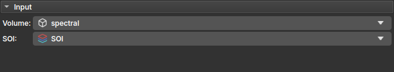 |
|:-----------------------------------------------:|
| Figure 5: Input section. |

#### Spectral axis

Gives each slice an energy: enter the label of the axis and the values of the **first** and the **last** slice with the slices in between evenly spaced. The **Energies used** control chooses the range of energies used by the fit, which lets you leave out the noisy or saturated ends (three energies is the minimum).

The plot shows the **histogram of the attenuation of each slice** (log scale of the number of pixels). The attenuation falls with the energy, and the bands that split at low energy are the different materials. After the clustering, the fitted curve of each cluster is drawn over the histogram.

The **Exponent b** field sets the exponent of the model. When $b$ changes, $a$ and $c$ are rescaled and the clouds of the $(c, a)$ plane change shape.

| 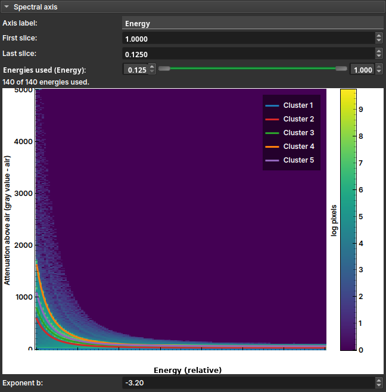 |
|:-----------------------------------------------:|
| Figure 6: Spectral axis section with the histogram of the attenuation per energy and the curve of each cluster. |

#### Calibration with standards (optional)

Converts $(c, a)$ into electron density, Zeff and density.

1. The standards of the table (**Standard**, **Formula**, **Density**) are searched automatically **outside the SOI**: the pixels outside it are clustered by how their attenuation varies with the energy, and the clusters that fit the standards are taken (each one is recognized by its pattern, since $c$ follows the electron density and $a/c$ follows the Zeff). To use your own standards, choose in **Standards segmentation** a segmentation with one segment per standard. To leave a standard out, clear its row.
2. If **Estimate b** is checked, the module also looks for the exponent $b$ that best fits the spectra of the standards (searched between -6 and -1) and sets it in **Exponent b**.
3. **Calibrate** fits the constants β, K and n. The two plots show where each standard falls relative to the calibration lines (known electron density against measured $c$, and known Zeff against measured $a/c$). Standards more than 8% away from the calibration are marked.

In the example, the calibration finds $b = -3.2$, $\beta = 39.96$ and $K = 5.96 \times 10^{-5}$.

| 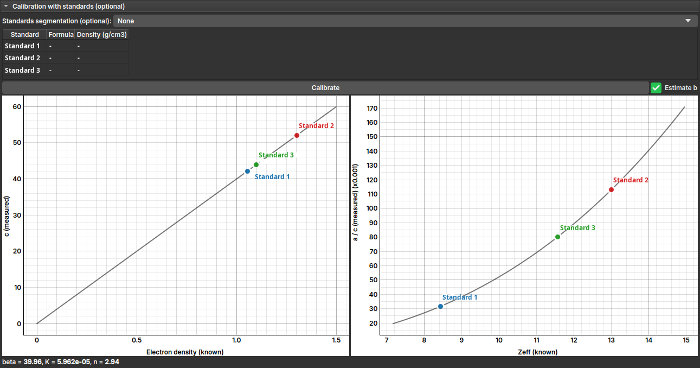 |
|:-----------------------------------------------:|
| Figure 7: Calibration with standards section. On the left, measured $c$ against the known electron density; on the right, $a/c$ against the known Zeff. |

#### Clustering

Groups the pixels in the $(c, a)$ plane and creates **one segment per cluster**.

- **Method:** *Gaussian mixture* (default), *K-means* or hierarchical clustering (*Ward*, *average*, *complete*). The hierarchical ones use a sample of 4000 pixels. Every method ends as **one Gaussian per cluster** (mean and covariance), which is what the plot shows and what classifies the pixels.
- **Clusters:** number of Gaussians (2 to 16).
- **Minimum confidence:** pixels whose most probable class has a probability below this value (default 90%) are left out. This removes uncertain pixels and most ring artifacts. The value 0 keeps every pixel.
- **Work on segmentation:** choose a previous result (or any segmentation of the volume) and each segment becomes a Gaussian on the plot. Drag the handles to adjust it and the segmentation is updated when you release them.
- **Output name:** name of the result. The default includes the volume, the exponent, the number of clusters and the method.

**Cluster and segment** creates the segmentation and a `<name>_properties` table. The list below the plot shows, for each cluster, the percentage of pixels and the values of $c$ and $a$, besides the fraction left out as undecided.

**Check stability** repeats the clustering with small changes (another random start, exponent ±0.2, 10% of the energies left out) and measures how many pixels keep their cluster. It also creates a map of that agreement, useful to see where the classification is fragile.

| 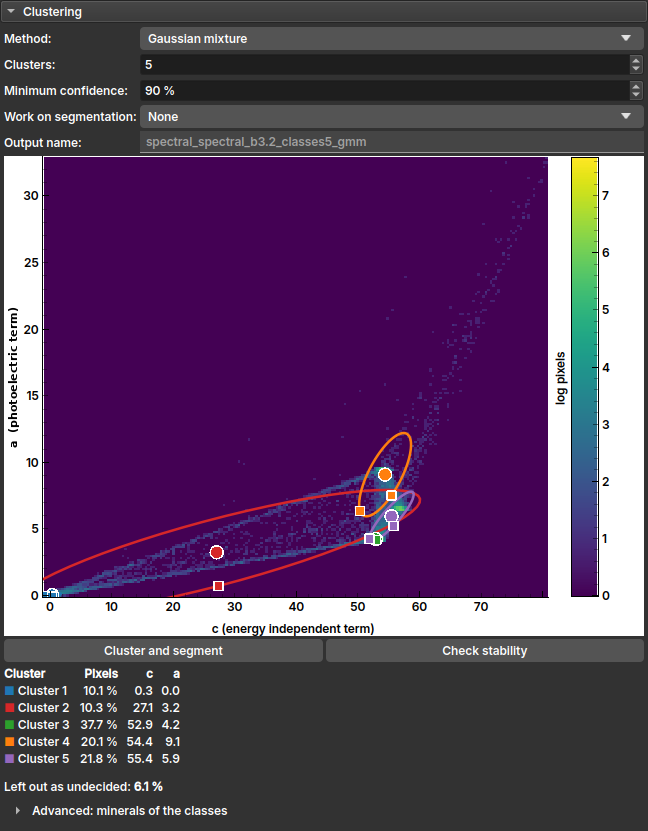 |
|:-----------------------------------------------:|
| Figure 8: Clustering section. The plot is the 2D histogram of the $(c, a)$ plane. The tail towards high $a$ is the pyrite grains. |

##### Advanced: minerals of the classes

Opens the table with the properties of each class: percentage of pixels, electron density, Zeff, density and **mineral**. The mineral starts as the reference mineral (quartz, calcite, aragonite, dolomite, ankerite, siderite, anhydrite, gypsum or pyrite) whose Zeff and density are closest to the class, or *Pores* when there is no attenuation (density below 0.8 g/cm³; in that case the Zeff is not shown). Change the mineral in the list if you know it is another one and use **Name the segments after the minerals** to rename the segments (repeated names are numbered).

| 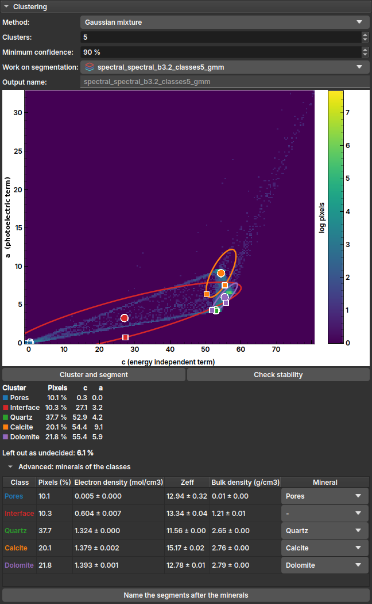 |
|:-----------------------------------------------:|
| Figure 9: Editable Gaussians in the $(c, a)$ plane and the table with the minerals of the classes. |

---

### Part 2: 3D segmentation with Dual Energy

The **Dual energy 3D** section classifies every voxel of two volumes (one per voltage) and creates the 3D segmentation. There are two methods, chosen in **Method**.

#### Common inputs

- **First energy volume** and **Second energy volume:** the two volumes, with the same size (and, preferably, aligned). The module warns when the spacing or the origin differ.
- **Region (SOI):** the segmented region, made of all the segments of the chosen segmentation, in any slice and with any shape. Without a SOI, the one of the Input section applies (which is of a cross section and is repeated in every slice) or, if there is none, the whole volume. **The SOI also defines what is left out**, and the standards are searched outside it.
- **References (standards, air):** a segmentation with one segment per standard, in the Dual Energy volumes, and optionally a segment named *Air*. They calibrate the gray values of the volumes. The **Auto** button creates this segmentation (see below).
- **Minimum confidence:** voxels whose most probable class has a probability below this value are left without a class (label 0). The default is 0%: every voxel gets the nearest class.
- **Output name:** name of the final segmentation. The default is `dual_multienergy_calib` (classes of the scan method) or `dual_cluster_classes{n}` (clusters method, with *n* the number of clusters).

#### Standards and air found in the volumes (Auto button)

The **Auto** button looks for the standards directly in the Dual Energy volumes, **outside the SOI**, and creates the `dual_standards` segmentation:

1. The pixels outside the SOI (slightly dilated), in a few slices, are clustered by a Gaussian mixture on the two gray values.
2. Only the **uniform** (compact) regions are kept, that is, those with a small spread of the gray value.
3. The **air** is the darkest compact region.
4. The **standards** are the combination of regions, in ascending order of gray, that best fits the density and Zeff calibration of the table of standards (the worst relative deviation must stay below 5%).
5. The mask of each region is made of the pixels within 3σ of the chosen Gaussian, refined to remove the mixed borders.

The result is a guess: check the segments on the image. The summary of the section tells how well the references fit the model of the volumes (here, within 0.2%).

| 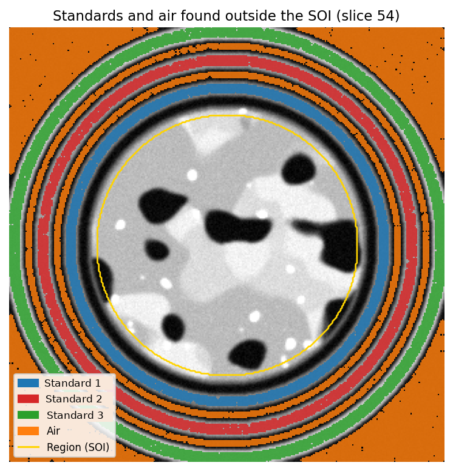 |
|:-----------------------------------------------:|
| Figure 10: Standards and air found outside the SOI (yellow outline). The rings are the calibration cylinders. |

With the references, the module measures the gray value of the air and of each standard in both volumes and fits the linear model of the fundamentals. This puts the two volumes on the same physical scale, without the energies.

#### Method 1: Classes of the multi-energy scan

Uses the multi-energy scan to know **which classes exist** (names, colors and position in the slice) and the 3D volumes to classify every voxel.

Choose in **Classes from segmentation** the segmentation made by the Clustering section (or adjusted by it). When you click **Segment the 3D volumes**, the module proceeds as follows.

The cross section of the multi-energy scan is also a slice of the 3D volumes, but with another pixel size (0.072 mm against 0.064 mm), another offset and another position in *z*. The module finds where it is by maximizing the **normalized cross-correlation** between the slice of the scan (the mean of the highest energies) and the slices of the first volume. The search tries the position in *z* (in steps of 0.4 mm), then refines the *x, y* offset and the slice. The scale is the ratio of the pixel sizes. Once the classes are taken to that slice, each one marks, in the Dual Energy volumes, the voxels that the scan says belong to it.

The result of the registration is shown as `slice 54 of the first volume, position (29, 33) pixels, correlation 0.98`. A correlation below 0.4 means that the slices are probably not the same cross section.

| 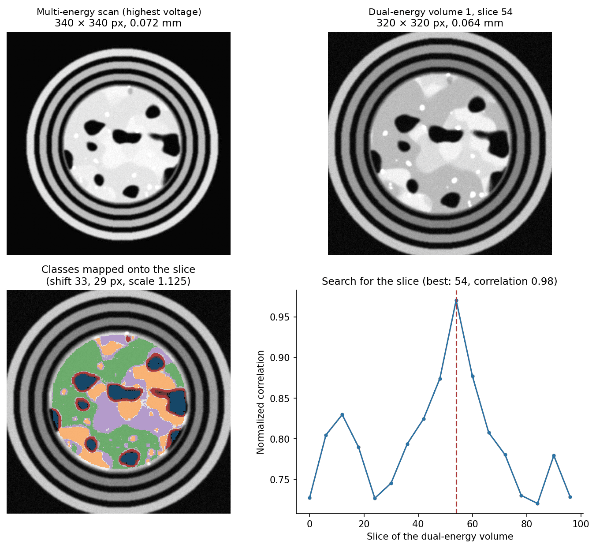 |
|:-----------------------------------------------:|
| Figure 11: Registration. The multi-energy scan (top left) is compared with the first volume (top right); below, the classes of the scan taken to the slice of the volume and the correlation as a function of the slice, with the maximum at slice 54. |

Then, for each class, the module measures a **Gaussian in the (gray of volume 1, gray of volume 2) plane** using the voxels of the **core** of the class in the registered slice (the class eroded by 3 pixels, plus 1 slice on each side), where classes do not mix. Atypical voxels (beyond 3.5σ, such as saturated grains) are discarded, and a small minimum variance avoids degenerate Gaussians. The weight $w_k$ of each class is its share of the samples.

A voxel with gray values $x$ goes to the class that maximizes

$$ \ln w_k - \tfrac{1}{2}\ln|\Sigma_k| - \tfrac{1}{2}\,(x-\mu_k)^{T}\,\Sigma_k^{-1}\,(x-\mu_k) $$

with $\mu_k$ and $\Sigma_k$ the mean and the covariance of the Gaussian of the class $k$. Because the plane $(\rho_e, \rho_e Z_{eff}^n)$ is an affine transformation of the plane of the grays, the result is the same in both.

| 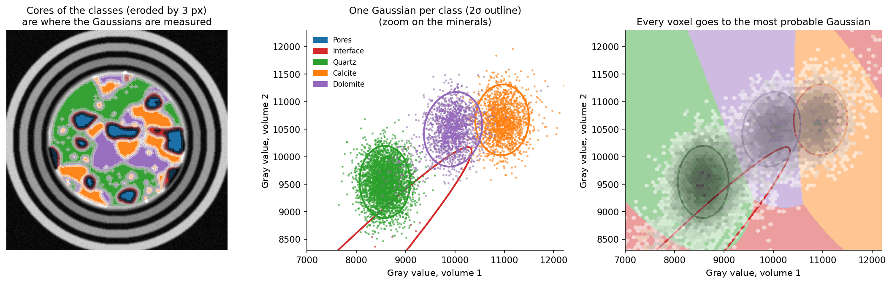 |
|:-----------------------------------------------:|
| Figure 12: Left, the cores of the classes (eroded by 3 px) on the slice. Center, the voxels of the cores and the Gaussian of each class (2σ outline), zoomed on the minerals. Right, the region of each class in the plane and the 2D histogram of the voxels of the SOI: every voxel goes to the most probable Gaussian. |

Every voxel of the volumes is assigned to the most probable class (or is left without a class if the probability is below **Minimum confidence**); the classification runs in blocks of slices, so large volumes are processed without exhausting the RAM, and a progress bar with a **Cancel** button is shown in the module. Finally, with the calibration of the volumes by the standards, the `<name>_properties` table is filled with the electron density, the Zeff, the density (each with the spread of the voxels of the class) and the suggested mineral of each class.

#### Method 2: Cluster the 3D volumes

Does not use the multi-energy scan. The voxels of the volumes (inside the SOI) are grouped by their two gray values into as many clusters as you ask in **Clusters** (2 to 12, default 4), with a Gaussian mixture fitted to a sample of 200,000 voxels. Include the pores in the count: one more cluster than the number of minerals you expect is a good start.

After classifying, the module computes the electron density, the Zeff and the density of each cluster with the calibration of the standards and **names each cluster with the suggested mineral** (clusters with no compatible mineral keep the name *Cluster n*). Different clusters can get the same mineral (they are numbered), and a name is only a suggestion: read the properties before trusting the names.

| 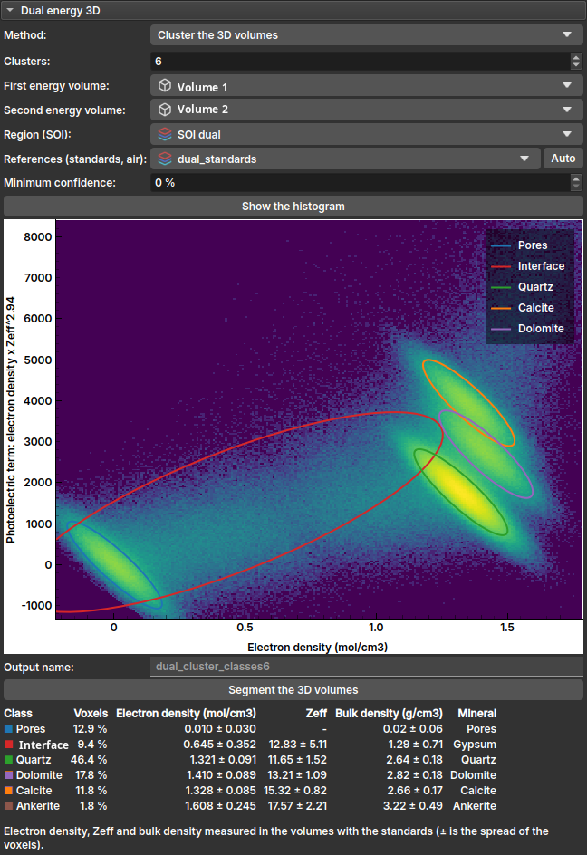 |
|:-----------------------------------------------:|
| Figure 13: Dual energy 3D section with the Cluster the 3D volumes method. The summary below the button has the properties of each cluster. |

#### Result

The segmentation has **one segment per class**, with the names and colors of the classes (or of the suggested minerals, in the clusters method). It is created as a label volume of 1 byte per voxel and converted into a segmentation at the end. The `<name>_properties` table is placed next to it in the hierarchy.

| 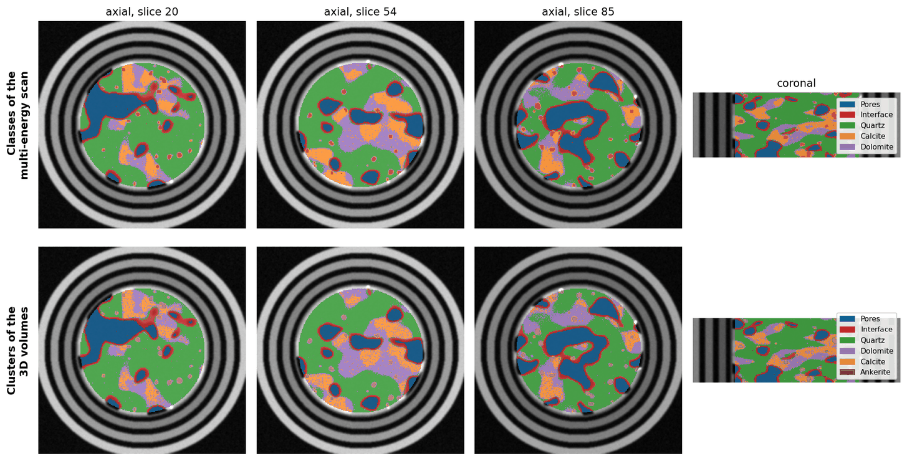 |
|:-----------------------------------------------:|
| Figure 14: 3D segmentation in axial cuts and in a coronal cut. Top, the classes of the multi-energy scan; bottom, the clustering of the volumes in 6 clusters, which also separates calcite from dolomite. |

At the end of the segmentation, the section shows a report with the registration, the properties of each class and how much the result agrees with the classes of the scan in its slice. The same values go to the properties table, which has the columns **Segment**, **Voxels (%)**, **Electron density (mol/cm3)**, **Zeff**, **Bulk density (g/cm3)** and **Mineral**, each property with its own error column.

| 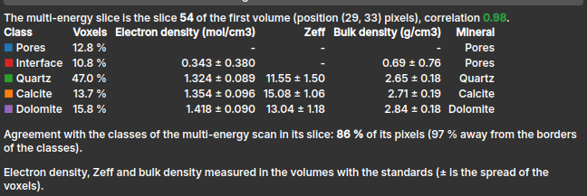 |
|:-----------------------------------------------:|
| Figure 15: Report of the segmentation with the classes of the multi-energy scan. |

Example of the table:

| Segment | Voxels (%) | Electron density (mol/cm³) | Zeff | Bulk density (g/cm³) | Mineral |
|:--|--:|:--|:--|:--|:--|
| Pores | 12.8 | - | - | - | Pores |
| Quartz | 47.0 | 1.324 ± 0.089 | 11.55 ± 1.50 | 2.65 ± 0.18 | Quartz |
| Calcite | 13.7 | 1.354 ± 0.096 | 15.08 ± 1.06 | 2.71 ± 0.19 | Calcite |
| Dolomite | 15.8 | 1.418 ± 0.090 | 13.04 ± 1.18 | 2.84 ± 0.18 | Dolomite |

#### How to interpret it and limits

- **Check the registration.** A high correlation (above about 0.8) and the classes sitting over the same features of the slice show that the classes were taken to the right place. The Gaussians are learned in a single slice: if the sample changes a lot along *z*, check the classes in distant slices.
- **Zeff and density are estimates.** The standards calibrate the gray of the volumes, but in real scans the effective energy depends on the material (beam hardening), so the density may be a few percent off, and the Zeff of classes with a large spread is noisy (see the spread in the table).
- **Small grains.** Grains of just a few voxels, like the pyrite of the sample, have few voxels and get no class of their own.
- **The values of the multi-energy scan and of Dual Energy may differ** in real scans (for example, in the parameter $a$ of the same mineral), because the effective energies are different. That is why the properties of the 3D result always come from the calibration with standards **in the Dual Energy volumes**, and the multi-energy scan only defines the classes.
- If there is no multi-energy scan, or its classes do not represent the 3D volume well, use the **Cluster the 3D volumes** method.
