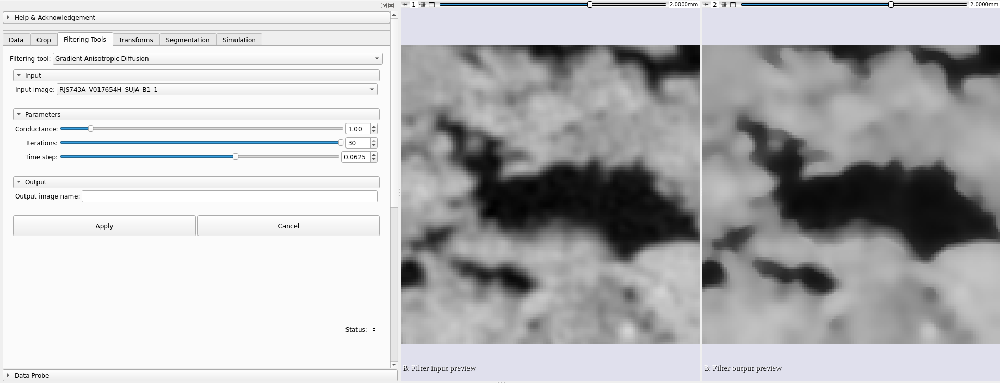
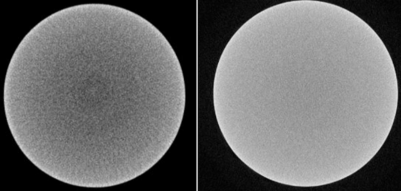
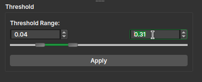

## Gradient Anisotropic Diffusion

Em muitas aplicações, assume-se que transições de uma região clara para uma escura (caracterizadas por um alto gradiente) sejam de interesse. Enquanto outros filtros, como de mediana e gaussiana, frequentemente borram as fronteiras, deixando a delimitação dos poros mais confusa, os filtros de difusão anisotrópica tendem a evitar esse tipo de confusão. O termo de condutância é uma função da magnitude do gradiente da imagem em cada ponto, reduzindo a força da difusão nas bordas.

|                                                                                  |
|:------------------------------------------------------------------------------------------------------------------------:|
| Esquerda: Volume original, sem correção. Direita: Após correção feita com filtro de difusão de gradiente anisotrópico. |

A implementação numérica dessa equação disponível no _GeoSlicer_ é similar à descrita no artigo de Perona-Malik, porém usa uma técnica mais robusta para estimativa da magnitude do gradiente e é generalizado para N-dimensões.

Os parâmetros do módulo para o cálculo do gradiente de difusão anisotrópica são:

- **Condutância** (_Conductance_): Controla a sensibilidade do termo de condutância. Como regra geral, quanto menor o valor, mais fortemente o filtro preservará as bordas. Um alto valor causará difusão (suavização) das bordas. Note que o número de iterações controla o quanto haverá de suavização dentro de regiões delimitadas pelas bordas.

- **Iterações** (_Iterations_): Quanto mais iterações, maior suavização. Cada iteração leva a mesma quantidade de tempo. Se uma iteração leva 10 segundos, 10 iterações levam 100 segundos.

- **Passo temporal** (_Time step_): O passo temporal depende da dimensionalidade da imagem. Para imagens tridimensionais, o valor padrão de de 0.0625 fornece uma solução estável. Na prática, a alteração deste parâmetro causa poucas alterações na imagem.

---

## Curvature Anisotropic Diffusion

Realiza difusão anisotrópica em uma imagem usando uma equação de difusão de curvatura modificada (_Modified Curvature Diffusion Equation_, MCDE).

O MCDE não exibe as propriedades de realce de borda da difusão anisotrópica clássica, que sob certas condições pode sofrer uma difusão "negativa", que aumenta o contraste das bordas. A difusão anisotropica de curvatura sempre sofre difusão positiva, com o termo de condutância variando apenas a força dessa difusão.

Qualitativamente, o MCDE se compara bem com outras técnicas de difusão não linear. É menos sensível ao contraste do que a difusão clássica do tipo Perona-Malik e preserva estruturas mais finas e detalhadas nas imagens. Existe uma potencial desvantagem de velocidade ao usar esta função em vez do *Gradient Anisotropic Diffusion*. Cada iteração da solução leva aproximadamente o dobro do tempo. Menos iterações, no entanto, podem ser necessárias para alcançar uma solução aceitável.

Os parâmetros necessários para o cálculo do gradiente de difusão anisotrópica são os mesmos do método do gradiente anisotrópico.

---

## Gaussian Blur Image Filter

Aplica um filtro de desfoque gaussiano ao volume, o único parâmetro é _Sigma_, representando a largura da gaussiana em unidades de mm.

---

## Median Image Filter

Aplica um filtro de mediana ao volume, o parâmetro _Neighborhood size_ define o tamanho da vizinhança em voxels em cada uma das direções.

---

## Non-Local Means Filter

Remove ruído preservando bordas e texturas finas. Para cada voxel, o filtro busca em sua vizinhança _patches_ de aparência semelhante e faz a média dos voxels centrais desses _patches_, dando mais peso aos mais semelhantes. Ao contrário dos filtros gaussiano e de mediana, que fazem a média apenas dos vizinhos imediatos, ele faz a média de regiões parecidas mesmo que estejam a alguns voxels de distância, preservando melhor contornos de grãos e poros pequenos. A implementação utilizada é a do [scikit-image](https://scikit-image.org/docs/stable/api/skimage.restoration.html#skimage.restoration.denoise_nl_means).

Os parâmetros do módulo são:

- **Modo** (_Mode_): _3D_ compara _patches_ em todo o volume, usando a informação das fatias vizinhas. _2D (slice by slice)_ filtra cada fatia axial de forma independente, o que é mais rápido e adequado a imagens com grandes diferenças entre fatias.

- **Intensidade** (_Strength (× noise std)_): Intensidade _h_ do filtro, como múltiplo do desvio padrão do ruído. Valores maiores suavizam mais, ao custo de detalhes finos. Os valores recomendados são de 0,45 a 0,6 em 3D e de 0,6 a 0,8 em 2D. Ao trocar o modo, a intensidade passa ao padrão do novo modo (0,5 em 3D, 0,7 em 2D), a menos que tenha sido editada.

- **Desvio padrão do ruído** (_Noise std_): Desvio padrão do ruído da imagem, em unidades de intensidade. Com _Estimate_ marcado, ele é estimado a partir da própria imagem, ignorando as regiões nulas ao redor da amostra. Desmarque para digitar um valor conhecido. Os valores utilizados são exibidos abaixo do botão _Apply_ ao final da filtragem.

- **Tamanho do patch** (_Patch size (voxels)_): Lado dos _patches_ comparados para encontrar regiões semelhantes. _Patches_ maiores são mais robustos ao ruído, porém mais lentos, e podem borrar estruturas menores que o _patch_.

- **Distância de busca** (_Search distance (voxels)_): Distância máxima para buscar _patches_ semelhantes. O tempo de processamento cresce rapidamente com este valor, principalmente em 3D.

- **Modo rápido** (_Fast mode_): Usa uma comparação de _patches_ mais rápida, com pesos uniformes. Desmarcado, as comparações são ponderadas por uma gaussiana, o que é um pouco mais preciso, porém muito mais lento. Disponível apenas em 2D, pois o modo 3D sempre usa a comparação rápida.

Voxels com o valor nulo da imagem são mantidos inalterados. Imagens RGB, geralmente imagens em tons de cinza exportadas com três canais, são convertidas para tons de cinza em um único canal antes da filtragem, e um aviso é exibido acima do botão _Apply_ quando isso ocorrer.

---

## Simple Filters

Esse módulo, carregado a partir do 3D Slicer original, apresenta um conjunto diverso de filtros para calcular a morfologia binária e em escala de cinza, remoção de ruído, limiar, manipulação de intensidade da imagem, crescimento de regiões, transformada de Fourier, etc. Para uma explicação mais detalhada de cada uma das opções disponíveis nesse módulo, consulte a documentação [específica](https://slicer.readthedocs.io/en/latest/user_guide/modules/simplefilters.html).

---

## Polynomial Shading Correction

Imagens de tomografia frequentemente apresentam variações nos valores de intensidade que não são características da amostra, mas sim do equipamento que as coletou. Essas variações são chamadas de artefatos, e existem diversos tipos deles. O módulo *Polynomial Shading Correction* corrige o artefato conhecido como _beam hardening_, entre outros. Também é conhecido como correção de _background_. 

|                                                                                  |
|:------------------------------------------------------------------------------------------------------------------------:|
| Esquerda: artefato de _beam hardening_ presente. Direita: imagem corrigida após aplicação de _shading correction_. |

Todo o procedimento descrito a seguir é feito fatia-a-fatia, no plano axial (eixo-z) da amostra.

Para cada fatia, baseado no parâmetro "Number of fitting points", uma amostra aleatória é feita em valores de intensidade, em pontos pertencentes à máscara de sombreamento. Esses pontos são utilizados para o fit de uma função polinomial de segundo grau em duas variáveis, que define o background da imagem:

$$ f(x,y) = a (x-b)^2+c(y-d)^2+e(x-b)+f(y-d)+g(x-b)(y-d) + h $$

A função ajustada é então utilizada para fazer a correção na fatia, seguindo a equação:

$$ s'(x,y) = \frac{s(x,y)}{f(x,y)}M $$
Onde, $s'(x,y)$ é a fatia corrigida, $s(x,y)$ é a original e $M$ é a média de todo o dado na máscara de sombreamento (valor constante).

O fluxo de trabalho do módulo _Shading Correction_ é dividido em três etapas: inicialização, definição da máscara de amostragem e processamento.

#### Inicialização

1.  **Input image:** Selecione a imagem de entrada que deseja corrigir.
2.  **Keep intermediate image:** Marque esta opção se desejar manter a imagem pré-normalizada que é gerada durante a etapa de inicialização. Esta imagem intermediária facilita a etapa de limiarização (_threshold_).
3.  Clique no botão **Initialize**. Isso irá pré-normalizar a imagem de entrada e preparar o editor de segmentos para a criação da máscara de amostragem.

#### Threshold

1.  Após a inicialização, uma interface do editor de segmentos com o efeito **Threshold** será exibida para criar uma máscara que cubra as áreas da imagem afetadas pelo sombreamento. Esta máscara será usada para amostrar os pontos para o ajuste do polinômio.
2.  Após ajustar o limiar, clique em **Apply** no painel do efeito Threshold.

!!!tip
	Leve em consideração o mineral no qual o efeito de _beam hardening_ estiver aparecendo mais claramente. Por exemplo: Se esse for o caso da calcita, basta clicar + arrastar com o mouse próximo de uma região com esse mineral, um circulo amarelo deve aparecer e você deve ver a segmentação colorindo próximo a região, a depender do raio desse círculo.

!!!tip
	Para um ajuste mais fino e sensível da segmentação, vá com o mouse para cima de uma das caixas de seleção com os valores máximo/mínimo e utilize a roleta do mouse para aumentar ou diminuir o limite superior/inferior.
	
	

#### Seleção de Parâmetros

1.  **Slice group size:** Defina o número de fatias que compartilharão a mesma função polinomial ajustada.
2.  **Number of fitting points:** Defina o número de pontos a serem amostrados da máscara para o ajuste da função.
3.  **Output image name:** Insira um nome para a imagem de saída corrigida.

#### Aplicar

1.  **Apply:** Clique para iniciar o processo de correção na imagem de entrada.
2.  **Apply to full volume:** Se a sua imagem de entrada for uma imagem virtual (_lazy node_), este botão estará visível. Clicar nele abrirá o módulo **Polynomial Shading Correction Big Image**, que é otimizado para processar imagens grandes. Os parâmetros definidos neste módulo serão automaticamente transferidos para o módulo de imagem grande.

---

## Ring Artifact Removal

Remove artefatos em anel de volumes de CT/micro-CT já reconstruídos. A correção é feita fatia a fatia, em torno de um ou mais centros marcados pelo usuário: o viés sistemático que é constante em um dado raio (igual em todos os ângulos) é isolado e subtraído, sem reamostrar a imagem, para não borrar a textura real. Um segundo modo, _Radial fan_, remove listras que emanam de um ponto fixo (por exemplo, uma inclusão densa ou grão metálico).

### Uso
1. Selecione o **Input volume**.
2. Escolha o **Artifact type**: _Ring (circular)_ ou _Radial fan (streaks emanating from a point)_.
3. Em **Correction**, clique em _Add point_ para colocar um marcador em um centro estimado e arraste-o até o centro de cada anel visível. No modo _Ring_, a estimativa é o centro de rotação guardado com o volume (quando o arquivo o tem) ou, caso contrário, o centro da imagem. Sem nenhum marcador, a correção usa essa mesma estimativa. No modo _Radial fan_, marque exatamente um ponto; o marcador é colocado sobre o grão denso de onde as listras saem, encontrado automaticamente.
4. Ajuste os parâmetros: _Ring width_ (modo Ring), ou _Streak width_ e _Radial coherence_ (modo Radial fan). Opcionalmente, defina um **Radius range** (em pixels a partir de cada ponto) para corrigir apenas essa faixa; a correção entra e sai gradualmente nas pontas, e _No limit_ deixa a ponta externa aberta.
5. Clique em **Preview on current slice** para ver a fatia antes, depois e a diferença (antes - depois) lado a lado. Use **Exit preview** para voltar ao layout anterior.
6. Defina o **Output name** e clique em **Apply to entire volume**.

!!!note
	Nem todo padrão radial é um artefato em anel clássico. Se a correção for desprezível mesmo com o centro bem ajustado, o padrão provavelmente é um artefato do tipo "zinger", que só pode ser corrigido adequadamente no sinograma, antes da reconstrução.
