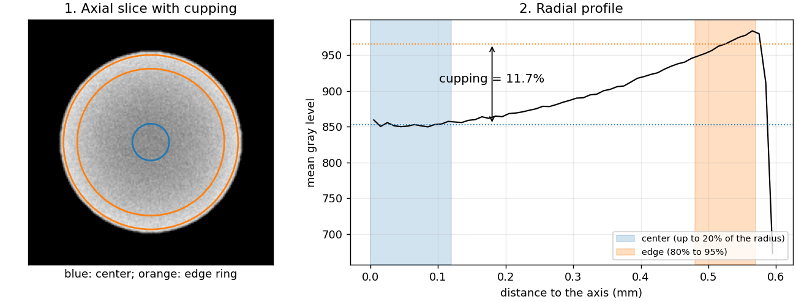
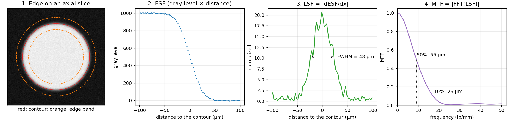
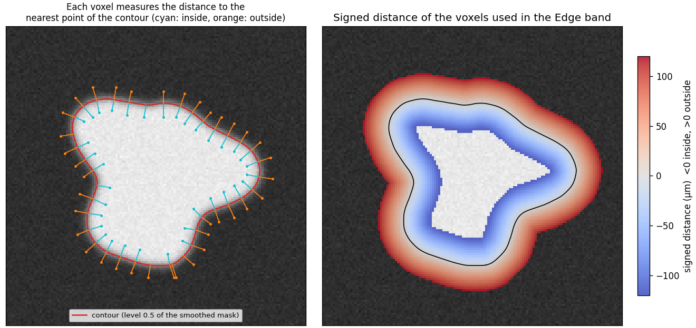

## Image Metrics

Mede a qualidade de um volume de microCT a partir de regiões segmentadas: relação sinal-ruído (SNR), relação contraste-ruído (CNR), cupping e resolução espacial (MTF, função de transferência de modulação) ao longo de uma borda. Cada execução adiciona uma linha a uma tabela de resultados permitindo comparar scans feitos com configurações de aquisição diferentes e exportar o resultado em CSV.

### Como usar

O módulo trabalha a partir de **uma segmentação com um segmento para cada material do scan**. Cada métrica pergunta então quais desses segmentos usar, e um único clique em **Apply** mede o scan inteiro.

#### Entrada

1. **Volume:** o volume de microCT reconstruído.
2. **Segmentation:** a segmentação com os segmentos do scan.

#### Métricas

Cada métrica tem a sua caixa. Marque as que quiser e escolha os segmentos dela. O botão **?** ao lado de cada caixa explica em detalhe o que a métrica significa e como lê-la.

| Métrica | O que diz | Segmentos a escolher |
|:--|:--|:--|
| **SNR** | Ruído: média / desvio padrão dos níveis de cinza. Maior é mais limpo. | Qualquer número de segmentos, marcados numa lista. É reportado um SNR para cada um. Use áreas homogêneas, longe de interfaces. |
| **CNR** | Se duas fases são distinguíveis: \|média A − média B\| / sqrt(dp A² + dp B²). | **Phase A** e **Phase B**, quaisquer dois segmentos do scan. Não precisam se tocar. |
| **Cupping (%)** | Endurecimento de feixe: (médiaborda − médiacentro) / médiaborda × 100. Perto de 0 é bom, e positivo significa centro mais escuro que a parede. | **Region**: *All segments* (padrão, a amostra inteira como uma região só) ou um único segmento. Deve ser a seção inteira. Se a segmentação tem um segmento de poro ou ar, escolha os segmentos da amostra um a um, porque o poro puxaria a média radial. |
| **MTF** | Resolução espacial: tamanho do menor detalhe resolvido a 50% e a 10% do contraste (µm), FWHM da LSF. Menor é mais nítido. | **Side A** e **Side B** de uma borda, por exemplo dentro e fora do tubo. Devem **se tocar**. |

#### Como o cupping é medido

|                                     { width=65% }                                     |
|:--:|
| Cilindro sintético com endurecimento de feixe. 1: uma fatia axial, com o centro (azul) e o anel da borda (laranja). 2: perfil radial, com as duas regiões e o cupping resultante. Os rótulos da figura estão em inglês, como na interface. |

1. **Eixo.** O eixo do tubo é assumido paralelo a Z e passa pelo centroide da região escolhida.
2. **Perfil radial.** Calcula-se a média do nível de cinza em função da distância ao eixo. Com endurecimento de feixe, o centro fica mais escuro que a parede, então o perfil sobe em direção à borda.
3. **Centro e borda.** O centro é a média até uma porcentagem do raio (padrão 20%) e a borda é a média entre duas porcentagens (padrão 80% a 95%), o que exclui os voxels da interface.
4. **Cupping (%)** = (médiaborda − médiacentro) / médiaborda × 100. Na figura, 853 no centro e 966 na borda dão 11,7%.

#### Como a MTF é medida

A MTF é obtida a partir do borrão de uma única borda, em quatro passos:

|                                                                          |
|:--:|
| Tubo sintético com borrão de 2 voxels (voxels de 10 µm) e ruído. 1: uma fatia axial, com o contorno da interface (vermelho) e a edge band (tracejado). 2: ESF. 3: LSF e sua FWHM. 4: MTF com os níveis de 50% e 10%. Os rótulos da figura estão em inglês, como na interface. |

1. **Localizar a borda.** Em cada fatia axial, o contorno entre o lado A e o lado B é encontrado com precisão sub-voxel. Só os voxels dentro da **Edge band** do contorno são usados. Ela é a meia-largura dessa região, em voxels: use pelo menos 4 vezes o borrão esperado (o padrão de 10 voxels serve para bordas borradas em poucos voxels).
2. **ESF (função de espalhamento de borda).** Cada voxel dá um ponto: sua distância ao contorno (negativa no lado A, positiva no lado B) e seu nível de cinza. A média dos pontos por distância, em todas as fatias, dá o perfil da borda. Uma borda nítida é um degrau, uma borda borrada é uma rampa.
3. **LSF (função de espalhamento de linha).** É o módulo da derivada da ESF, normalizado para área unitária. É um pico centrado na borda: quanto mais estreito o pico, mais nítida a imagem. Sua largura à meia altura é a **LSF FWHM**.
4. **MTF.** É o módulo da transformada de Fourier da LSF, normalizado para 1 na frequência zero. Diz que fração do contraste sobrevive em cada frequência espacial (em pares de linha por mm). A frequência em que ela cai a 50% e a 10% é convertida no tamanho do detalhe, 1 / (2 f), e reportada como **Resolvable at 50%** e **Resolvable at 10%**.

Uma LSF larga significa uma MTF estreita: uma imagem mais borrada perde o contraste dos detalhes pequenos em frequências mais baixas.

!!! note "Bordas curvas"
    A distância é medida até o ponto mais próximo do contorno, ou seja, perpendicularmente à borda em cada trecho, então a MTF funciona também para bordas curvas, como a de um grão. Ela é calculada dentro da fatia axial, e por isso a borda deve ser aproximadamente paralela a Z.

    |                                     { width=65% }                                     |
    |:--:|
    | Grão de forma irregular numa fatia axial. Esquerda: cada voxel é ligado ao ponto mais próximo do contorno (vermelho). Direita: distância com sinal dos voxels dentro da edge band (negativa dentro do grão). Os rótulos da figura estão em inglês, como na interface. |

#### Como ler a MTF

A MTF diz quanto do contraste de um detalhe sobrevive conforme o detalhe diminui. Ela começa em 100% para detalhes grandes e cai à medida que eles encolhem. A tabela reporta dois pontos dessa curva, como o tamanho do detalhe (em µm):

| Coluna | Significado |
|:--|:--|
| **Resolvable at 50% (µm)** | Tamanho do detalhe que mantém **metade** do contraste. Detalhes desse tamanho ainda são vistos com clareza. Fica na parte de alto contraste da curva, por isso o ruído a afeta pouco: é o melhor valor para comparar equipamentos ou configurações de aquisição. |
| **Resolvable at 10% (µm)** | Tamanho do detalhe que mantém **um décimo** do contraste. É o limite prático da imagem: detalhes menores se perdem no ruído. Como está na parte baixa da curva, é mais sensível ao ruído. |
| **LSF FWHM (µm)** | Largura da borda borrada à meia altura: outra forma de ver o mesmo borrão. |

Por exemplo, com voxels de 10 µm, *50% = 30 µm* e *10% = 18 µm* significa que detalhes de 30 µm aparecem com metade do contraste, os entre 18 e 30 µm esmaecem e nada abaixo de 18 µm é resolvido. O gráfico da MTF mostra o contraste mantido para cada tamanho de detalhe em µm (tamanho = 500 / f, onde f é a frequência em pares de linha por mm) e marca esses dois tamanhos.

!!! note
    A interface da MTF deve ser aproximadamente perpendicular às fatias, como a parede de um tubo ao longo de Z ou uma face plana paralela a Z. Numa interface quase horizontal, como o topo de uma amostra, as fatias axiais a cortam obliquamente e a borda parece mais borrada do que é. Os segmentos podem ser feitos por limiar da própria imagem: o contorno é suavizado, então o ruído da segmentação não deixa a borda medida mais nítida. Testes com bordas sintéticas recuperam o f50 e o FWHM da LSF com erro de cerca de 2% para borrões entre 0,8 e 3 voxels.

!!! tip
    Uma métrica que não pode ser calculada (por exemplo, uma MTF entre segmentos que não se tocam) não impede as outras. O módulo adiciona a linha com o que funcionou e lista o que falhou.

#### Siglas

| Sigla | Significado |
|:--|:--|
| **SNR** | _Signal-to-Noise Ratio_, relação sinal-ruído |
| **CNR** | _Contrast-to-Noise Ratio_, relação contraste-ruído |
| **MTF** | _Modulation Transfer Function_, função de transferência de modulação: a fração do contraste de um detalhe que a imagem preserva, em função do tamanho do detalhe |
| **ESF** | _Edge Spread Function_, função de espalhamento de borda: o nível de cinza ao longo de uma borda, em função da distância a ela |
| **LSF** | _Line Spread Function_, função de espalhamento de linha: a derivada da ESF; sua largura mede o borrão |
| **FWHM** | _Full Width at Half Maximum_, largura à meia altura: a largura de um pico na metade da sua altura |
| **LSF FWHM** | A FWHM da LSF, em µm: a largura da borda borrada à meia altura. É a coluna da tabela de resultados; menor é mais nítido |
| **lp/mm** | Pares de linha por milímetro: a unidade de frequência espacial da MTF |

#### Resultados

- Os gráficos mostram o perfil radial e a curva de MTF da última execução, com os níveis de 50% e 10%.
- **Clear table** remove todas as linhas e **Export CSV** salva a tabela.
