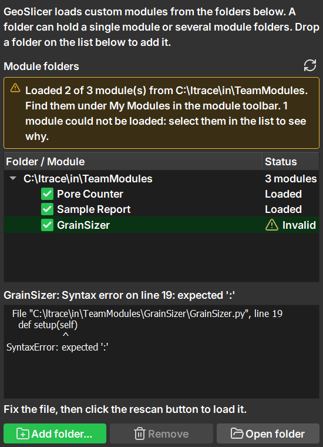

# Gerenciador de Módulos

O **_Module Manager_** carrega módulos personalizados, desenvolvidos por usuários ou equipes fora do GeoSlicer, diretamente de pastas no disco. Os módulos são executados a partir das suas próprias pastas, portanto nada é copiado para a instalação do GeoSlicer, e compartilhar um módulo com colegas é tão simples quanto compartilhar a sua pasta, por exemplo em uma unidade de rede.

O módulo pode ser aberto pelo botão **Module Manager** na barra de diálogos, no canto inferior direito, ou pela opção **Manage modules...** do menu **My Modules** na barra de módulos.

### Pastas de módulos

A lista no centro do módulo mostra as pastas registradas e os módulos encontrados em cada uma delas. Uma pasta registrada pode ser:

- A pasta de um único módulo, como `MeuModulo/` contendo `MeuModulo.py`;
- Uma coleção de pastas de módulos, como `ModulosDaEquipe/` contendo `MeuModulo/MeuModulo.py` e `OutroModulo/OutroModulo.py`. As coleções podem ser agrupadas em mais um nível, como em `ModulosDaEquipe/Imagens/MeuModulo/MeuModulo.py`.

Para adicionar uma pasta, clique em **Add folder...** ou arraste-a do navegador de arquivos e solte-a sobre a lista de pastas. Soltar o arquivo `.py` de um módulo adiciona a pasta em que ele está, e várias pastas podem ser soltas de uma vez. Links simbólicos são seguidos.

Cada módulo aparece sob uma única pasta. Adicionar uma pasta cujos módulos já estão na lista, como um módulo dentro de uma coleção registrada, apenas os seleciona na lista. Adicionar uma coleção que inclui pastas registradas as substitui.

Módulos adicionados depois a uma coleção registrada são encontrados na próxima vez que o GeoSlicer for iniciado, ou imediatamente ao clicar no botão de atualizar acima da lista de pastas.

Uma pasta em uma unidade de rede que não pode ser acessada aparece como **Not reachable** e é ignorada, para não atrasar a inicialização do GeoSlicer. Ela é verificada novamente na próxima atualização.

Os botões abaixo da lista atuam sobre a pasta selecionada:

- **Remove**: deixa de carregar os módulos da pasta. Os seus módulos continuam carregados até o GeoSlicer ser reiniciado;
- **Show in files**: mostra a pasta no navegador de arquivos.

O resultado de cada ação, como quantos módulos foram carregados de uma pasta, é exibido em uma mensagem entre o título "Module folders" e a lista.

### Usando módulos personalizados

Os módulos carregados são listados em **My Modules**, no final da barra de módulos. O botão **Add Module** ao lado leva direto à seleção de pasta: se a pasta escolhida contém um único módulo, esse módulo é aberto; caso contrário, o **_Module Manager_** é aberto para mostrar o que foi carregado.

Um clique duplo em um módulo na lista de pastas também o abre.

Módulos personalizados exibem ferramentas de desenvolvedor, marcadas como **DEV**, no cabeçalho do painel do módulo, ao lado do botão do manual:

- O botão de recarregar aplica as alterações no código do módulo sem reiniciar o GeoSlicer;
- O botão de editar abre o arquivo do módulo no editor de Python definido nas configurações da aplicação.

### Habilitando e desabilitando módulos

Cada módulo na lista de pastas tem uma caixa de seleção. Desmarcá-la desabilita o módulo: ele deixa de ser carregado na próxima vez que o GeoSlicer for iniciado. Marcá-la novamente carrega o módulo imediatamente. A escolha é lembrada para cada arquivo de módulo.

!!! note "Observação"
    O GeoSlicer não consegue descarregar um módulo que já foi carregado. Um módulo desabilitado só deixa de ser executado depois que o GeoSlicer é reiniciado.

### Escrevendo um módulo

[Criar um novo módulo do GeoSlicer](https://github.com/petrobras/GeoSlicer/blob/main/CONTRIBUTING.md#create-a-new-geoslicer-module)

### Módulos com erros

Módulos que não podem ser carregados são marcados com um ícone de aviso na lista de pastas. Ao selecionar um deles, o seu erro é exibido abaixo da lista, junto com o traceback quando houver. Os erros se dividem em dois grupos:

- **Invalid**: um arquivo com o mesmo nome da sua pasta (como `MeuModulo/MeuModulo.py`) tem um erro de sintaxe, não define uma classe com o mesmo nome do arquivo, ou a sua classe não deriva de `LTracePlugin` ou não define `self.parent.categories`. Nenhuma parte do seu código é executada, então, assim que o arquivo for corrigido, o módulo é carregado na próxima atualização;
- **Failed to load**: o módulo gerou um erro ao ser carregado. Ele é desabilitado, para que não seja executado novamente a cada inicialização, e o seu erro é guardado. Depois de corrigir o erro, marque o módulo para carregá-lo novamente.

Se o GeoSlicer fechar inesperadamente enquanto carrega um módulo personalizado, esse módulo é desabilitado na próxima inicialização e uma mensagem informa qual foi. Ele continua desabilitado até ser marcado novamente.
