## Spectral Profile

O módulo **Spectral Profile** segmenta uma amostra a partir de **como a atenuação de cada pixel varia com a energia dos raios X**. Minerais diferentes podem ter a mesma atenuação em uma única energia, mas respondem de forma diferente quando a energia muda: o efeito fotoelétrico (que depende do número atômico) cai rápido com a energia, enquanto o espalhamento Compton (que depende da densidade eletrônica) quase não muda. Medir a amostra em várias energias separa esses dois efeitos.

O módulo trabalha com dois tipos de dado, que se complementam:

- **Scan multienergia (2D):** uma seção transversal da amostra escaneada com muitas tensões de tubo, uma fatia por tensão. O eixo *z* do volume é o eixo de energia, não a profundidade. Esse dado separa bem os minerais e é usado para descobrir **quais são as classes** da amostra.
- **Volumes de Dual Energy (3D):** a amostra inteira escaneada em apenas duas energias. Cobrem o volume todo, mas com apenas dois valores por voxel. A segmentação 3D usa esses dois volumes.

O resultado é sempre uma **segmentação** acompanhada de uma **tabela de propriedades** (`<nome>_properties`) com a densidade eletrônica, o número atômico efetivo (Zeff), a densidade e o mineral sugerido de cada classe.

!!! note "Sobre as imagens"
    Todas as imagens desta página vêm de uma **amostra sintética**, gerada com o mesmo modelo físico que o módulo usa, com ruído: um cilindro com quartzo, calcita, dolomita, alguns grãos de pirita e poros, e uma fatia multienergia dele.

| 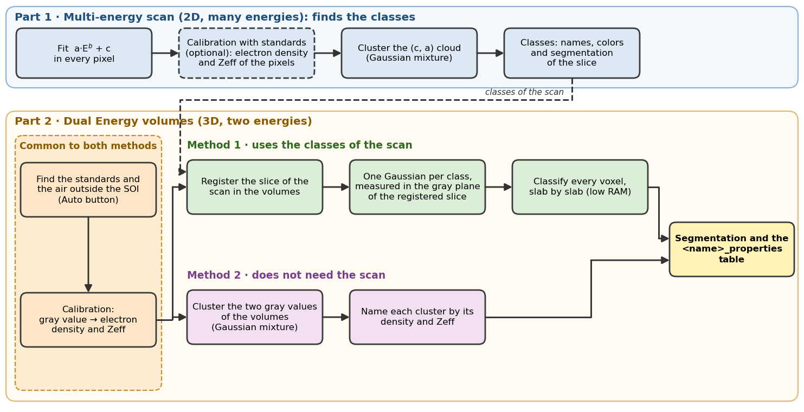 |
|:-----------------------------------------------:|
| Figura 1: Visão geral do módulo. A Parte 1 (scan multienergia) encontra as classes; a calibração com padrões dela (tracejada) é opcional. Na Parte 2, a calibração com os padrões dos volumes de Dual Energy é comum aos dois métodos. O Método 1 usa as classes do scan; o Método 2 funciona sem o scan. |

!!! note "Quando usar cada parte"
    - Só tem o scan multienergia 2D: use as seções **Input**, **Spectral axis**, **Calibration with standards** e **Clustering** (Parte 1).
    - Tem os volumes de Dual Energy 3D: use a seção **Dual energy 3D** (Parte 2). Ela pode aproveitar as classes do scan multienergia ou funcionar sozinha, agrupando os dois volumes.

---

### Fundamentos

#### Por que mais de uma energia

A atenuação de um material na tensão de tubo $E$ tem duas contribuições de comportamento muito diferente:

- a contribuição **Compton**, quase constante com a energia, proporcional à **densidade eletrônica** $\rho_e$;
- a contribuição **fotoelétrica**, que cresce rápido em direção às baixas energias e é proporcional a $\rho_e \cdot Z_{eff}^{\,n}$, em que $Z_{eff}$ é o número atômico efetivo.

Em alta energia só a primeira permanece, e minerais de densidade parecida ficam iguais. Em baixa energia a segunda aparece e separa minerais de composição diferente, como o quartzo, a dolomita e a calcita abaixo.

| 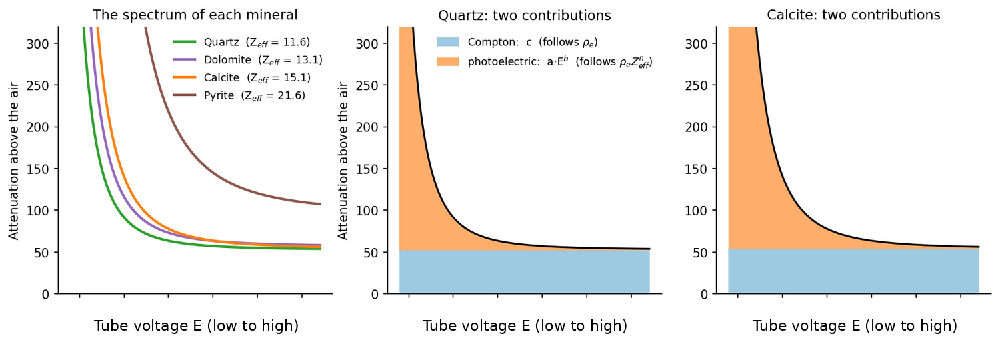 |
|:-----------------------------------------------:|
| Figura 2: Atenuação de quatro minerais em função da tensão do tubo (esquerda) e suas duas contribuições para o quartzo e a calcita (centro e direita). As curvas são quase iguais em tensão alta e se separam em tensão baixa. |

#### O modelo de atenuação

Em cada pixel do scan multienergia, a atenuação (valor de cinza acima do ar) é ajustada por

$$ \text{atenuação}(E) = a \cdot E^{\,b} + c $$

em que $E$ é a tensão do tubo, em uma escala que mantém $a$ e $c$ com tamanhos parecidos.

- **c** é o termo independente da energia, dominado pelo espalhamento Compton. Ele acompanha a **densidade eletrônica**: $c = \beta \cdot \rho_e$.
- **a** é o termo fotoelétrico (a atenuação que ele acrescenta em $E = 1$). Ele acompanha a densidade eletrônica e, rapidamente, o número atômico efetivo: $a = c \cdot K \cdot Z_{eff}^{\,n}$.
- **b** é o expoente de energia (padrão -3,5). A absorção fotoelétrica varia com $E^{-3}$ a $E^{-3,5}$, então $b$ costuma ficar entre -3 e -3,5.

Cada pixel passa a ser descrito por apenas dois números, $(c, a)$. As linhas de $\rho_e$ constante são verticais e as de $Z_{eff}$ constante são raios saindo da origem, então cada material é um ponto desse plano e minerais diferentes ocupam regiões diferentes dele. A clusterização é feita nesse plano.

| 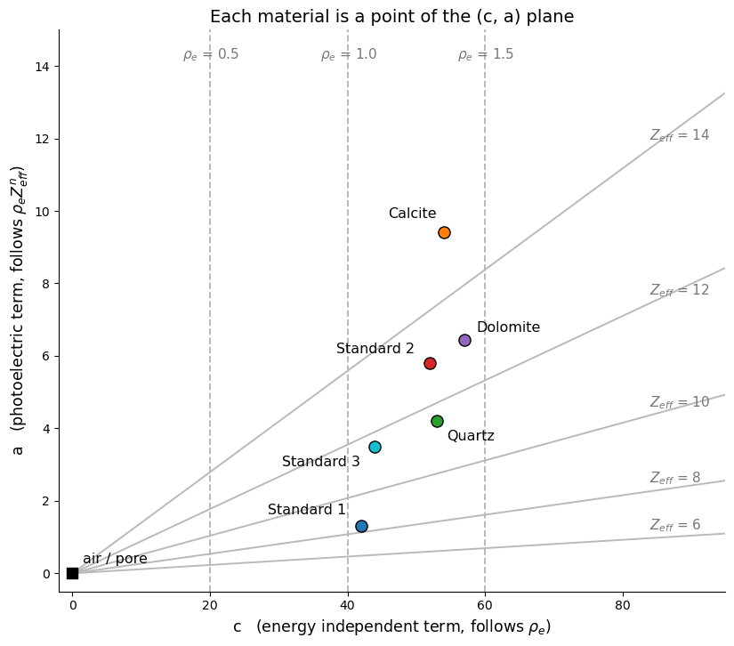 |
|:-----------------------------------------------:|
| Figura 3: O plano $(c, a)$. Tracejadas verticais: densidade eletrônica constante. Raios: $Z_{eff}$ constante. |

| 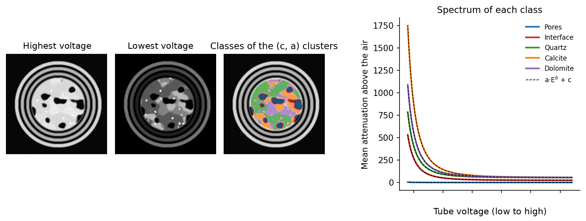 |
|:-----------------------------------------------:|
| Figura 4: Fatias do scan multienergia na maior e na menor tensão, as classes obtidas e o espectro médio de cada classe (linha cheia) com o ajuste $a \cdot E^b + c$ (tracejado). Em baixa energia as curvas se separam, e é essa separação que distingue os minerais. |

#### Calibração com padrões

O par $(c, a)$ não tem unidade física. Para convertê-lo em propriedades, o módulo usa **padrões** de composição e densidade conhecidas, escaneados junto com a amostra. A fórmula de cada um dá a densidade eletrônica e o Zeff. Com eles, o módulo ajusta duas relações:

- $c = \beta \cdot \rho_e$, de onde sai a **densidade eletrônica** (mol/cm³);
- $a / c = K \cdot Z_{eff}^{\,n}$, de onde sai o **Zeff**;
- a **densidade** (g/cm³) é a densidade eletrônica dividida por $Z/A = 0{,}4995$, valor típico dos minerais comuns. É uma estimativa, não uma medida.

#### O modelo nos volumes de Dual Energy

Nos volumes de Dual Energy, o valor de cinza de cada voxel em cada tensão $k$ segue o mesmo raciocínio:

$$ \text{cinza}_k = \text{ar}_k + S_k \cdot \rho_e \cdot \left(1 + R_k \cdot Z_{eff}^{\,n}\right) $$

onde $\text{ar}_k$ é o cinza do ar, $S_k$ é uma escala e $R_k$ é a razão entre a contribuição fotoelétrica e a Compton naquela tensão. Esse modelo é **linear** nos parâmetros $(\text{ar}_k,\ S_k,\ S_k R_k)$, então basta medir o cinza do ar e dos padrões nos dois volumes para ajustá-lo: **não é preciso informar energias**, pois o efeito da energia efetiva fica embutido em $R_k$. Invertendo o modelo para os dois volumes, cada voxel recebe $\rho_e$ e $Z_{eff}$.

Cada voxel é um ponto do plano dos dois valores de cinza. As linhas de $\rho_e$ constante e de $Z_{eff}$ constante formam uma grade nele, e a transformação para o plano $(\rho_e,\ \rho_e Z_{eff}^{\,n})$ é **afim**: não muda a forma das classes. Por isso classificar com gaussianas medidas nos valores de cinza é o mesmo que classificar no plano de densidade.

---

### Parte 1: scan multienergia (2D)

#### Input

Selecione o volume multienergia (o eixo *z* contém as energias) e, opcionalmente, uma **SOI** (segmentação com a região de interesse). Só os pixels dentro da SOI são analisados, de forma que os cilindros de calibração, o suporte e o ar podem ficar de fora.

| 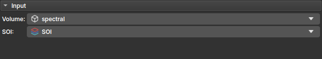 |
|:-----------------------------------------------:|
| Figura 5: Seção Input. |

#### Spectral axis

Associa cada fatia a uma energia: informe o rótulo do eixo e os valores da **primeira** e da **última** fatia com as fatias intermediárias igualmente espaçadas. O controle **Energies used** escolhe o intervalo de energias usado no ajuste, o que permite descartar as extremidades ruidosas ou saturadas (o mínimo é de três energias).

O gráfico mostra o **histograma de atenuação de cada fatia** (escala log de número de pixels). A atenuação cai com a energia, e as faixas que se separam em baixa energia são os diferentes materiais. Depois do agrupamento, a curva ajustada de cada cluster é desenhada sobre o histograma.

O campo **Exponent b** define o expoente do modelo. Ao mudar $b$, $a$ e $c$ são reescalados e as nuvens do plano $(c, a)$ mudam de forma.

| 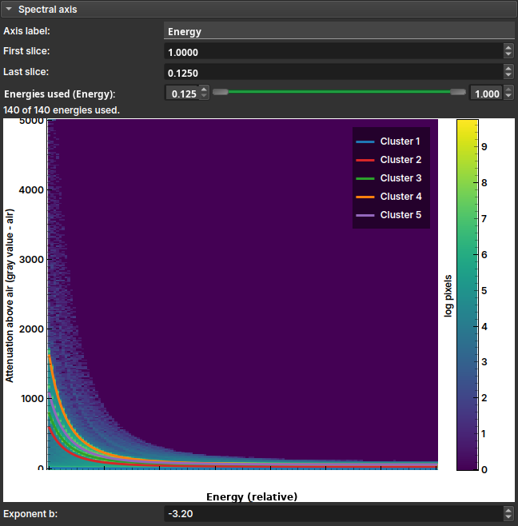 |
|:-----------------------------------------------:|
| Figura 6: Seção Spectral axis com o histograma de atenuação por energia e a curva de cada cluster. |

#### Calibration with standards (opcional)

Converte $(c, a)$ em densidade eletrônica, Zeff e densidade.

1. Os padrões da tabela (**Standard**, **Formula**, **Density**) são procurados automaticamente **fora da SOI**: os pixels fora dela são agrupados pelo modo como a atenuação varia com a energia, e os grupos compatíveis com os padrões são escolhidos (cada um é reconhecido pelo seu padrão, pois $c$ segue a densidade eletrônica e $a/c$ segue o Zeff). Para usar seus próprios padrões, escolha em **Standards segmentation** uma segmentação com um segmento por padrão. Para deixar um padrão de fora, apague a linha dele.
2. Se **Estimate b** estiver marcado, o módulo também procura o expoente $b$ que melhor ajusta o espectro dos padrões (busca entre -6 e -1) e o define em **Exponent b**.
3. **Calibrate** ajusta as constantes β, K e n. Os dois gráficos mostram onde cada padrão cai em relação às retas de calibração (densidade eletrônica conhecida contra $c$ medido, e Zeff conhecido contra $a/c$ medido). Padrões a mais de 8% da calibração são marcados.

No exemplo, a calibração encontra $b = -3{,}2$, $\beta = 39{,}96$ e $K = 5{,}96 \times 10^{-5}$.

| 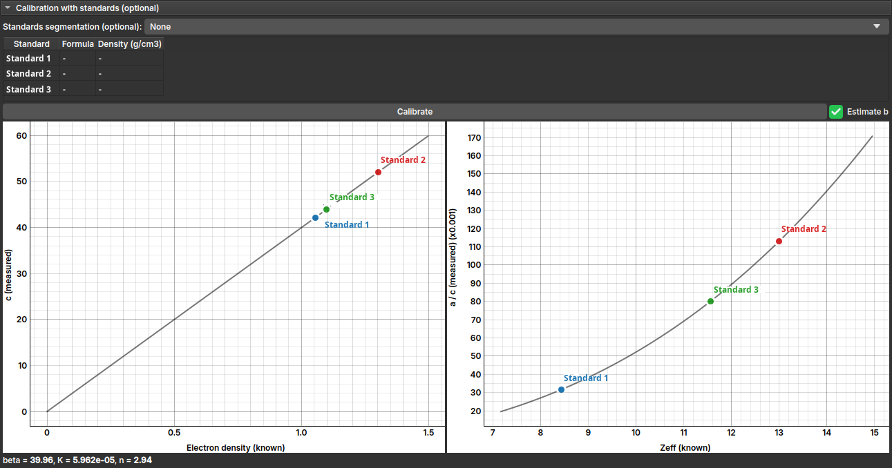 |
|:-----------------------------------------------:|
| Figura 7: Seção Calibration with standards. À esquerda, $c$ medido contra a densidade eletrônica conhecida; à direita, $a/c$ contra o Zeff conhecido. |

#### Clustering

Agrupa os pixels no plano $(c, a)$ e cria **um segmento por cluster**.

- **Method:** *Gaussian mixture* (padrão), *K-means* ou agrupamento hierárquico (*Ward*, *average*, *complete*). Os hierárquicos usam uma amostra de 4000 pixels. Todo método termina como **uma gaussiana por cluster** (média e covariância), que é o que o gráfico mostra e o que classifica os pixels.
- **Clusters:** número de gaussianas (de 2 a 16).
- **Minimum confidence:** pixels cuja classe mais provável tem probabilidade abaixo desse valor (padrão 90%) ficam de fora. Isso remove pixels incertos e a maior parte dos artefatos de anel. O valor 0 mantém todos os pixels.
- **Work on segmentation:** escolha um resultado anterior (ou qualquer segmentação do volume) e cada segmento vira uma gaussiana no gráfico. Arraste os pontos para ajustar e a segmentação é atualizada ao soltar.
- **Output name:** nome do resultado. O padrão inclui o volume, o expoente, o número de clusters e o método.

**Cluster and segment** cria a segmentação e uma tabela `<nome>_properties`. A lista abaixo do gráfico mostra, para cada cluster, a porcentagem de pixels e os valores de $c$ e $a$, além da fração deixada de fora por indecisão.

**Check stability** repete o agrupamento com pequenas perturbações (outro início aleatório, expoente ±0,2, 10% das energias removidas) e mede quantos pixels mantêm o cluster. Também cria um mapa dessa concordância, útil para ver onde a classificação é frágil.

| 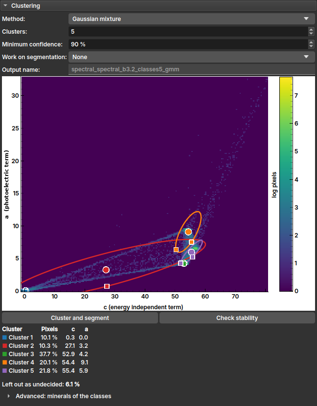 |
|:-----------------------------------------------:|
| Figura 8: Seção Clustering. O gráfico é o histograma 2D do plano $(c, a)$. A cauda em direção a $a$ alto são os grãos de pirita. |

##### Advanced: minerals of the classes

Abre a tabela com as propriedades de cada classe: porcentagem de pixels, densidade eletrônica, Zeff, densidade e **mineral**. O mineral começa como o mineral de referência (quartzo, calcita, aragonita, dolomita, ankerita, siderita, anidrita, gipsita ou pirita) cujo Zeff e densidade mais se aproximam da classe, ou *Pores* quando não há atenuação (densidade abaixo de 0,8 g/cm³; nesse caso o Zeff não é mostrado). Troque o mineral na lista se souber que é outro e use **Name the segments after the minerals** para renomear os segmentos (nomes repetidos são numerados).

| 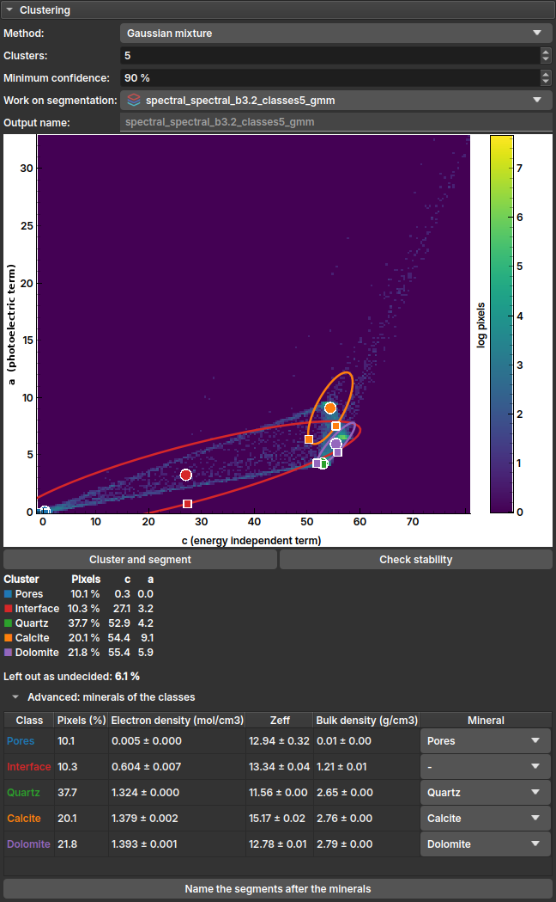 |
|:-----------------------------------------------:|
| Figura 9: Gaussianas editáveis no plano $(c, a)$ e a tabela de minerais das classes. |

---

### Parte 2: segmentação 3D com Dual Energy

A seção **Dual energy 3D** classifica todos os voxels de dois volumes (um por tensão) e cria a segmentação 3D. Há dois métodos, escolhidos em **Method**.

#### Entradas comuns

- **First energy volume** e **Second energy volume:** os dois volumes, com o mesmo tamanho (e, de preferência, alinhados). O módulo avisa se o espaçamento ou a origem forem diferentes.
- **Region (SOI):** região segmentada, formada por todos os segmentos da segmentação escolhida, em qualquer fatia e com qualquer forma. Sem uma SOI, vale a da seção Input (que é de uma seção transversal e se repete em todas as fatias) ou, se não houver, o volume inteiro. **A SOI também define o que fica de fora**, e é fora dela que os padrões são procurados.
- **References (standards, air):** segmentação com um segmento por padrão, nos volumes Dual Energy, e opcionalmente um segmento chamado *Air*. Eles calibram o valor de cinza dos volumes. O botão **Auto** cria essa segmentação (veja abaixo).
- **Minimum confidence:** voxels cuja classe mais provável tem probabilidade abaixo desse valor ficam sem classe (rótulo 0). O padrão é 0%: todo voxel recebe a classe mais próxima.
- **Output name:** nome da segmentação final. O padrão é `dual_multienergy_calib` (método das classes do scan) ou `dual_cluster_classes{n}` (método dos clusters, com *n* igual ao número de clusters).

#### Padrões e ar encontrados nos volumes (botão Auto)

O botão **Auto** procura os padrões diretamente nos volumes Dual Energy, **fora da SOI**, e cria a segmentação `dual_standards`:

1. Os pixels fora da SOI (levemente dilatada), em algumas fatias, são agrupados por uma mistura de gaussianas nos dois valores de cinza.
2. Ficam apenas as regiões **uniformes** (compactas), isto é, as que têm pouca dispersão de cinza.
3. O **ar** é a região compacta mais escura.
4. Os **padrões** são a combinação de regiões, em ordem crescente de cinza, que melhor ajusta a calibração de densidade e Zeff da tabela de padrões (o pior desvio relativo precisa ficar abaixo de 5%).
5. A máscara de cada região são os pixels a até 3σ da gaussiana escolhida, refinada para tirar as bordas misturadas.

O resultado é uma estimativa: confira os segmentos sobre a imagem. O resumo da seção informa o quanto as referências se ajustam ao modelo dos volumes (aqui, até 0,2%).

| 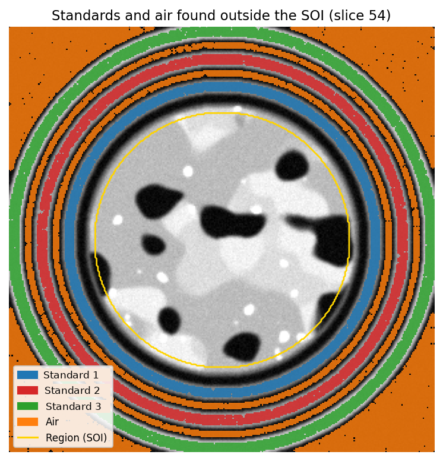 |
|:-----------------------------------------------:|
| Figura 10: Padrões e ar encontrados fora da SOI (contorno amarelo). Os anéis são os cilindros de calibração. |

Com as referências, o módulo mede o cinza do ar e de cada padrão nos dois volumes e ajusta o modelo linear dos fundamentos. Isso põe os dois volumes na mesma escala física, sem precisar das energias.

#### Método 1: Classes of the multi-energy scan

Usa o scan multienergia para saber **quais são as classes** (nomes, cores e posição na fatia) e os volumes 3D para classificar todos os voxels.

Escolha em **Classes from segmentation** a segmentação criada pela seção Clustering (ou ajustada por ela). Ao clicar em **Segment the 3D volumes**, o módulo procede como descrito a seguir.

A seção transversal do scan multienergia também é uma fatia dos volumes 3D, mas com outro tamanho de pixel (0,072 mm contra 0,064 mm), outro deslocamento e outra posição em *z*. O módulo encontra onde ela está maximizando a **correlação cruzada normalizada** entre a fatia do scan (a média das energias mais altas) e as fatias do primeiro volume. A busca testa a posição em *z* (em passos de 0,4 mm) e depois refina o deslocamento em *x, y* e a fatia. A escala é a razão entre os tamanhos de pixel. Depois que as classes são levadas para essa fatia, cada uma passa a marcar, nos volumes Dual Energy, os voxels que o scan diz serem dela.

O resultado do registro é mostrado como `fatia 54 do primeiro volume, posição (29, 33) pixels, correlação 0,98`. Uma correlação abaixo de 0,4 indica que as fatias provavelmente não são a mesma seção.

| 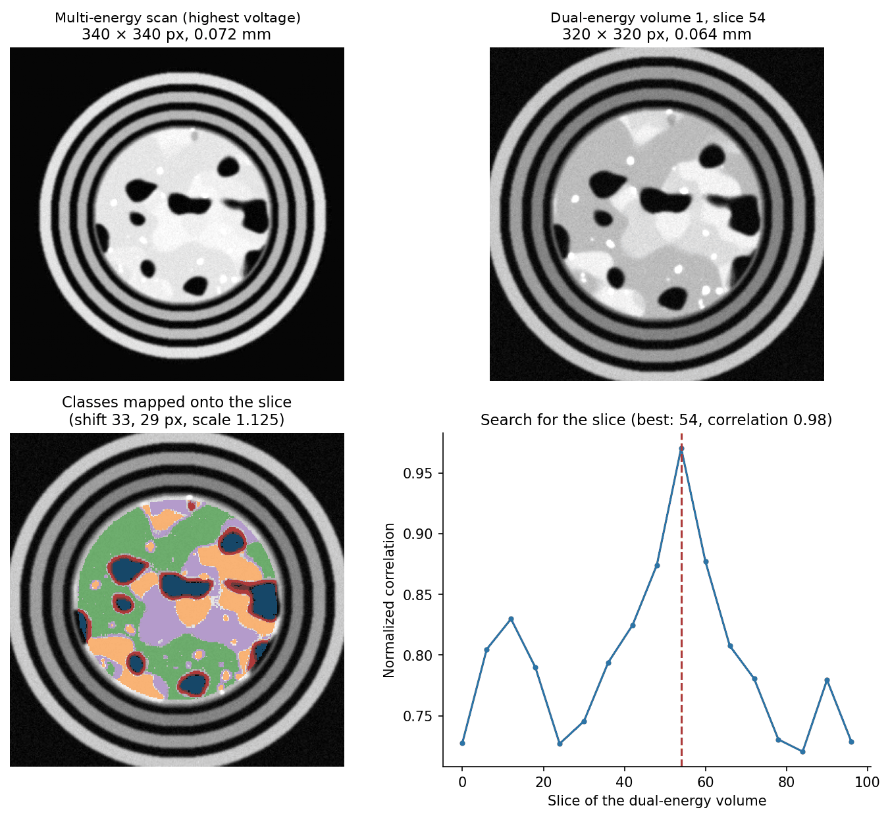 |
|:-----------------------------------------------:|
| Figura 11: Registro. O scan multienergia (alto à esquerda) é comparado com o primeiro volume (alto à direita); abaixo, as classes do scan levadas para a fatia do volume e a correlação em função da fatia, com o máximo na fatia 54. |

Em seguida, para cada classe, o módulo mede uma **gaussiana no plano (cinza do volume 1, cinza do volume 2)** usando os voxels do **núcleo** da classe na fatia registrada (a classe erodida em 3 pixels, mais 1 fatia de cada lado), onde não há mistura entre classes. Voxels atípicos (a mais de 3,5σ, como grãos saturados) são descartados, e uma pequena variância mínima evita gaussianas degeneradas. O peso $w_k$ de cada classe é a sua fração de amostras.

Um voxel com valores de cinza $x$ vai para a classe que maximiza

$$ \ln w_k - \tfrac{1}{2}\ln|\Sigma_k| - \tfrac{1}{2}\,(x-\mu_k)^{T}\,\Sigma_k^{-1}\,(x-\mu_k) $$

com $\mu_k$ e $\Sigma_k$ a média e a covariância da gaussiana da classe $k$. Como o plano $(\rho_e, \rho_e Z_{eff}^n)$ é uma transformação afim do plano dos cinzas, o resultado é o mesmo nos dois.

| 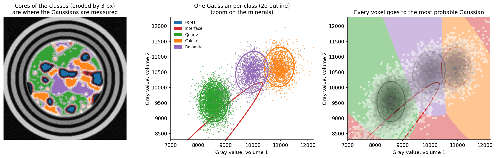 |
|:-----------------------------------------------:|
| Figura 12: À esquerda, os núcleos das classes (erodidos em 3 px) sobre a fatia. No centro, os voxels dos núcleos e a gaussiana de cada classe (contorno de 2σ), ampliados nos minerais. À direita, a região de cada classe no plano e o histograma 2D dos voxels da SOI: cada voxel vai para a gaussiana mais provável. |

Cada voxel dos volumes é atribuído à classe mais provável (ou fica sem classe, se a probabilidade ficar abaixo de **Minimum confidence**); a classificação é feita em blocos de fatias, de modo que volumes grandes são processados sem esgotar a RAM, e uma barra de progresso com um botão **Cancel** aparece no módulo. Por fim, com a calibração dos volumes pelos padrões, a tabela `<nome>_properties` é preenchida com a densidade eletrônica, o Zeff, a densidade (cada uma com o desvio dos voxels da classe) e o mineral sugerido de cada classe.

#### Método 2: Cluster the 3D volumes

Não usa o scan multienergia. Os voxels dos volumes (dentro da SOI) são agrupados pelos seus dois valores de cinza em tantos clusters quanto você pedir em **Clusters** (de 2 a 12, padrão 4), com uma mistura de gaussianas ajustada a uma amostra de 200.000 voxels. Inclua os poros na contagem: um cluster a mais do que o número de minerais esperado é um bom começo.

Depois de classificar, o módulo calcula a densidade eletrônica, o Zeff e a densidade de cada cluster com a calibração dos padrões e **nomeia cada cluster com o mineral sugerido** (os clusters sem mineral compatível mantêm o nome *Cluster n*). Clusters diferentes podem receber o mesmo mineral (eles são numerados), e o nome é só uma sugestão: leia as propriedades antes de confiar nos nomes.

| 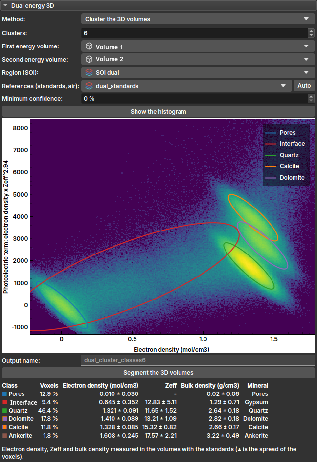 |
|:-----------------------------------------------:|
| Figura 13: Seção Dual energy 3D com o método Cluster the 3D volumes. O resumo abaixo do botão traz as propriedades de cada cluster. |

#### Resultado

A segmentação contém **um segmento por classe**, com os nomes e as cores das classes (ou dos minerais sugeridos, no método dos clusters). Ela é criada como um volume de rótulos de 1 byte por voxel e convertida em segmentação ao final. A tabela `<nome>_properties` fica ao lado dela na hierarquia.

| 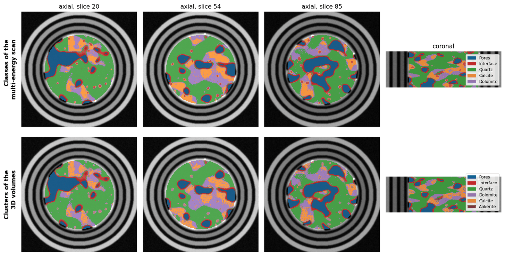 |
|:-----------------------------------------------:|
| Figura 14: Segmentação 3D em cortes axiais e em um corte coronal. Em cima, as classes do scan multienergia; embaixo, o agrupamento dos volumes em 6 clusters, que também separa a calcita da dolomita. |

Ao fim da segmentação, a seção mostra um relatório com o registro, as propriedades de cada classe e quanto o resultado concorda com as classes do scan na fatia dele. Os mesmos valores vão para a tabela de propriedades, que tem as colunas **Segment**, **Voxels (%)**, **Electron density (mol/cm3)**, **Zeff**, **Bulk density (g/cm3)** e **Mineral**, cada propriedade com a sua coluna de erro.

| 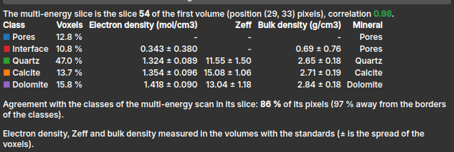 |
|:-----------------------------------------------:|
| Figura 15: Relatório da segmentação com as classes do scan multienergia. |

Exemplo da tabela:

| Segmento | Voxels (%) | Densidade eletrônica (mol/cm³) | Zeff | Densidade (g/cm³) | Mineral |
|:--|--:|:--|:--|:--|:--|
| Pores | 12,8 | - | - | - | Pores |
| Quartz | 47,0 | 1,324 ± 0,089 | 11,55 ± 1,50 | 2,65 ± 0,18 | Quartz |
| Calcite | 13,7 | 1,354 ± 0,096 | 15,08 ± 1,06 | 2,71 ± 0,19 | Calcite |
| Dolomite | 15,8 | 1,418 ± 0,090 | 13,04 ± 1,18 | 2,84 ± 0,18 | Dolomite |

#### Como interpretar e limites

- **Confira o registro.** Uma correlação alta (acima de cerca de 0,8) e as classes sobrepostas às mesmas feições da fatia indicam que as classes foram levadas para o lugar certo. As gaussianas são aprendidas em uma única fatia: se a amostra mudar muito ao longo de *z*, vale conferir classes em fatias distantes.
- **Zeff e densidade são estimativas.** Os padrões calibram o cinza dos volumes, mas em scans reais a energia efetiva depende do material (endurecimento do feixe), então a densidade pode ficar alguns por cento diferente da real, e o Zeff de classes com dispersão grande é ruidoso (veja o desvio na tabela).
- **Grãos pequenos.** Grãos de poucos voxels, como a pirita da amostra, têm poucos voxels e não ganham uma classe própria.
- **Os valores do scan multienergia e do Dual Energy podem diferir** em scans reais (por exemplo, no parâmetro $a$ de um mesmo mineral), porque as energias efetivas são diferentes. Por isso as propriedades do resultado 3D vêm sempre da calibração com padrões **nos volumes Dual Energy**, e o scan multienergia serve apenas para definir as classes.
- Se não houver scan multienergia, ou se as classes dele não representarem bem o volume 3D, use o método **Cluster the 3D volumes**.
